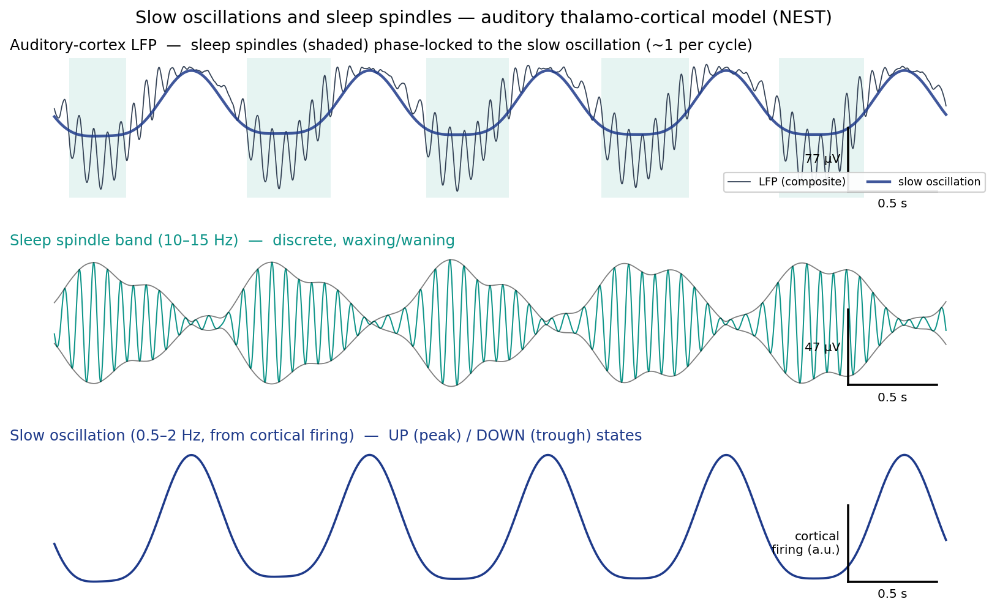

# Auditory thalamo-cortical sleep model

A closed-loop thalamo-cortical column for the **auditory** system that produces
the sleep **slow oscillation** with **spindles** nested on its UP states, and
that can be driven with sounds in sleep. The project has two lines:

- **NEURON** (`neuron/`, the current line): conductance-based neurons with
  intrinsic currents, run in parallel with MPI. 5,031 neurons and 1.16 M
  synapses at full scale, ~2.7-2.9x real time on 100 ranks of MareNostrum 5
  (MN5).
- **NEST** (the root-level `tc_*.py` scripts, the earlier line): point and
  Hodgkin-Huxley (`ht_neuron`) networks. Kept, and documented in
  [The earlier NEST model](#the-earlier-nest-model) below.

## The NEURON model


Full-scale configuration (scale 1.65), counted by building the network:

| population | neurons | cell model |
|---|---|---|
| L2/3 | 1056 E / 264 I | regular-spiking pyramid / fast-spiking basket |
| L4 | 1056 E / 264 I | regular-spiking pyramid (a stand-in for the spiny stellate) / basket |
| L5 | 874 E (437 intrinsically bursting + 437 RS) / 214 I | pyramid with persistent Na+ / basket |
| L6 | 693 E / 173 I | regular-spiking pyramid, corticothalamic |
| thalamus | TC 346, RE 91 | relay (I_T, Ca-dependent I_h) / reticular (I_T, SK2, K_Na) |

Wiring is a fixed convergence of 100 random sources per target and projection;
the thalamus is wired locally on a ring. Gap junctions couple RE cells and L5
bursting cells. Mechanisms (`neuron/mod/`): `IT`/`IT2` (T-type Ca2+ for relay
and reticular cells), `sk2` and `cad` (SK2 and its Ca2+ pool), `ihca`
(Ca-dependent I_h), `kna` (Na+-activated K+ in RE), `inap` (persistent Na+),
`ical`, `nmda` (L5 recurrent excitation), `kleak` (the sleep/wake leak) and
`gap`/`gapmpi`. The diagram above is drawn in the style of the cc model's
`CC.png`: red excitatory, blue inhibitory, width = sqrt(synapses). Other
diagrams: [thalamocortical loop](figures/architecture_thalamocortical.png),
[cortex](figures/architecture_cortex.png) and
[the Traub et al. 2005 cell types against this model](figures/architecture_traub.png)
(9 of Traub's 14 types are present).

The slow oscillation comes from the L5 bursting cells (persistent Na+ plus a
slowed SK2 / Ca2+ pool) reinforced by NMDA recurrence within L5, with Poisson
background input on cortical cells making it irregular. Spindles come from the
RE-TC loop.

### Where it stands


Full scale, 200 s (`PLAN-spindels.md`, Stage 3 round 2): slow oscillation
0.77 Hz with interval CV 0.38; 63% of UP states carry a spindle; 93% of
spindles are in 10-15 Hz and 98% waxing/waning, but the median length is 498 ms,
about one cycle short of the 0.5 s target.

- **Spindle refractoriness.** K_Na in RE gives a refractory period in the
  isolated thalamus (a second spindle 1.5 s later is ~40% weaker, recovering
  over 4-8 s). It has not yet been run at full scale.
- **Sounds in sleep** (`PLAN-auditory-input.md`, C1/C2, 342 tones, sham-controlled):
  tones in late DOWN start UP states more often (83% vs 50%); evoked spindles
  are reliable; L4 firing falls ~50% and L2/3 ~65% during a spindle. The
  thalamus is too excitable to sounds: the TC response is graded with level
  but evoked spindles are nearly all-or-none even at 30 dB.
  
- **Closed-loop stimulation (C3).** A causal detector of the UP volley
  (`neuron/closed_loop.py`) triggers a tone at a chosen delay. Offline it
  finds 92% of UP onsets with no false positives, ~3 ms after the volley peak.
  The stim/sham run on MN5 is in progress.
- **LFP at every level:** [per-level view](figures/c12_sham_s0_levels.png).
  Each level is z-scored separately, and the 10-15 Hz band of a cortical level
  is partly filter ringing; spindles are counted from spikes, not from the band.

Not in the model yet: a calibrated wake state (`--state wake` is a
placeholder), long-term synaptic plasticity (all synapses are static;
short-term plasticity is planned in `PLAN-architecture.md` Stage 2), and the
cell types and connection classes in the Traub comparison.

### Plans

| document | what | status |
|---|---|---|
| [`PLAN-spindels.md`](PLAN-spindels.md) | make the thalamus produce real spindles and an irregular SO | Stages 0-3 done; K_Na at full scale pending |
| [`PLAN-auditory-input.md`](PLAN-auditory-input.md) | sounds into the loop, awake and asleep | Stage A, C1, C2 done; C3 closed loop built, MN5 run in progress; Stage B (wake) not started |
| [`PLAN-architecture.md`](PLAN-architecture.md) | a Traub-like auditory column: more connections, SST/LTS, FRB, VIP, output splits | plan only, nothing implemented |
| [`Edu-questions.md`](Edu-questions.md) | how spindles are detected, what the LFP proxy is, the architecture in numbers | reference |
| [`neuron/README.md`](neuron/README.md) | the long history of the NEURON port | log |

### Run

NEURON comes from `pip install neuron` locally; on MN5 it is a module, never
pip. Build the mechanisms once, then run (on a laptop, scale 0.1 took ~15x real
time, measured with three runs in parallel):

```bash
python3 -m venv --system-site-packages .venv-neuron
.venv-neuron/bin/pip install neuron
(cd neuron && ../.venv-neuron/bin/nrnivmodl mod)
.venv-neuron/bin/python neuron/ctx_thalamus_mpi.py --scale 0.1 --tstop 20000 --conv 100 \
    --g-i-e-l5 0.02 --g-l5-rec 0.013 --tau2-l5-rec 200 --taur-l5e-rs 120 --l5-rec-mech nmda \
    --taur-l5-ib 2000 --g-gap 0.001 --thal-footprint 10 --ek-re -95 --taur-re 5 --g-tc-re 0.06 \
    --gh-tc 5e-6 --kl-scale-tc 1.422 --depth-tc 1 --taur-tc 5 --ginc-tc 4 --g-l6-tc 0.003 \
    --g-l6-re 0.01 --cx-noise-rate 200 --out out/test.npz
python3 neuron/ctx_analyze.py out/test.npz      # LFP, per-level, spindle and reconstruction figures
```

On MN5, `run_ctx_nrn.sh` bundles these settings (`SPINDLE=stage2`); the upload
and submit commands for every run are in [`MN5_NEURON.md`](MN5_NEURON.md).

### Layout

| path | purpose |
|---|---|
| `neuron/` | the model (`ctx_thalamus_mpi.py`, `cortex_neuron.py`, `tc_neuron.py`, `mod/`), the auditory input and closed loop (`auditory_input.py`, `closed_loop.py`), analysis (`ctx_analyze.py`, `aud_phase.py`, `cl_analyze.py`, `volley_stats.py`) |
| `figures/` | figures for the current model, including the architecture diagrams (`neuron/plot_architecture.py`) |
| `run_ctx_nrn.sh` | MN5 job script for the NEURON model |
| `config/`, `tc_*.py`, `run.sh` | the NEST line |
| `docs/` | NEST model equations and the spindle-review mapping |
| `res/`, `out/` | local only and git-ignored (job outputs, scratch figures). A few older figures remain tracked in `out/` |

## The earlier NEST model

A closed-loop thalamo-cortical column for the **auditory** system that, under
sleep drives, produces the **slow oscillation (~1 Hz)** with **sleep spindles
(~13 Hz)** nested on its UP states. Built directly in NEST, **no optimisation**.

It is built on the **Cortical Column (CC)** model
([max-talanov/cc](https://github.com/max-talanov/cc/tree/main/optimization_nest)):
a biophysically-grounded NEST model of a single canonical thalamo-cortical
column. CC captures the laminar cortical microcircuit — thalamic relay and
reticular populations together with cortical layers L4, L2/3, L5 and L6, each
with multiple excitatory pyramidal subtypes and inhibitory interneuron classes
(after Traub et al. 2005 and Markram et al. 2015) — as a network of
conductance-based neurons with probabilistic connectivity. CC is fundamentally
an **optimisation** framework: it fits the column's cellular and synaptic
parameters to target activity through a dedicated harness (`run_opt.py`,
`methods/`). The present model reuses that column as its cortical substrate and
repurposes it for sleep — dropping the optimisation, closing the thalamo-cortical
loop, and adding the sleep drives that generate slow waves and spindles.

Concretely, the column (from cc's `core/simulator.py`) is five stages of
`iaf_cond_exp` neurons — thalamus (TCR excitatory / nRT inhibitory), L4, L2/3
(RS + FRB), L5 (TuftRS + TuftIB), L6, with a shared L5/6 interneuron pool
(Basket / LTS / Axoaxonic) — wired with `pairwise_bernoulli` connections. Here
it is built once and run under sleep drives rather than optimised.

### Results



Simulated auditory-cortex LFP (top), decomposed into the **sleep spindle band
(10–15 Hz)** with its waxing/waning envelope (middle) and the **slow oscillation
(0.5–2 Hz)** derived from cortical firing (bottom). Spindles (shaded) are
**nested on the slow-oscillation UP state** — the canonical coupling; the figure
caption is set from a measurement (cortical firing at the spindle is 1.19× the
mean), not asserted. Produced by the AdEx configuration, which passes all ten
[Fernandez & Lüthi (2020)](https://doi.org/10.1152/physrev.00042.2018) spindle
criteria (`tc_validate.py`):

```bash
python3 tc_present.py --config config/network_auditory_adex.yaml --tstop 14000 --outdir out
```

Other figures each run writes: a five-panel overview, the SW/SP decomposition,
and a **per-layer view of the spindle propagating up the column**
(`out/tc_sleep_<tag>_layers.png`) — see [Run](#run).

### Neuron model

Two neuron models are selectable via `--neuron-model` (or `simulation.neuron_model`
in a config):

- **`iaf_cond_exp`** (default) — a leaky integrate-and-fire point neuron with
  conductance-based, exponential synapses; E/I routed by weight sign. Fast, and
  the rhythms are an **imposed-drive + loop-resonance hybrid** (1 Hz and 13 Hz
  `ac_generator`s).
- **`ht_neuron`** (Hodgkin–Huxley, Hill & Tononi 2005) — carries the intrinsic
  currents **I_T** (T-type Ca²⁺ rebound), **Iₕ** (pacemaker), **I_NaP** and
  **I_KNa**, with receptor-typed synapses (AMPA / NMDA / GABA_A / **GABA_B**).
  Here the rhythms are **emergent**: the ~1 Hz slow oscillation from cortical
  I_NaP/I_KNa bistability, and **sleep spindles from the RE↔TC loop** (the I_T
  rebound burst gated by reticular GABA_A/GABA_B inhibition) — no 13 Hz
  oscillator is injected. This yields **discrete, regular, waxing/waning
  spindles, one per slow-wave UP state**.

The full governing equations, the `aeif_cond_exp` fallback, the `ht_neuron`
intrinsic currents, and the parameter tables (with Mushtaq 2024 sources) are in
**[`docs/model_equations.md`](docs/model_equations.md)**.

For how this model maps onto the spindle literature — a summary of
Fernandez & Lüthi (2020, *Physiol Rev*), what we already capture, a prioritised
backlog, and designs for **SK2 channels in TRN** and an **external modulatory
spindle trigger** — see
**[`docs/spindle_review_mapping.md`](docs/spindle_review_mapping.md)**.

```bash
# emergent HH (Hodgkin-Huxley) sleep rhythms:
python3 tc_run.py --config config/network_auditory_hh.yaml --tstop 15000 --outdir out --tag hh
# or force the model on any config:
python3 tc_run.py --config config/network_auditory_local.yaml --neuron-model ht_neuron --outdir out
```

Under `ht_neuron` the emergent spindle frequency depends on network size
(≈10–11 Hz for the small thalamus, up to ~16 Hz for the 40 TC / 40 RE
resonator) — all within the physiological spindle band, consistent with
Mushtaq's finding that thalamic inhibition shifts spindle frequency.

### What this adds over the cc column

1. **A closed thalamo-cortical loop.** cc is feed-forward (thalamus→L4, L6→L5).
   We add the two missing return projections that close the loop:
   - **corticothalamic feedback** `L6_E → TCR` and `L6_E → nRT`;
   - **reciprocal reticular inhibition** `nRT → TCR` and `nRT → nRT`.
   The TCR↔nRT reciprocal loop is the canonical spindle generator; its delays
   are tuned so the round trip resonates near 13 Hz.

2. **Sleep drives** (`SleepParams`):
   - **Slow oscillation (1 Hz):** an `ac_generator` injects a ~1 Hz current into
     the cortical pyramidal pools so the column cycles between depolarised **UP**
     (firing) and silent **DOWN** states.
   - **Spindles (13 Hz):** a ~13 Hz `ac_generator` into the thalamus. The
     thalamic DC is biased so relay/reticular cells are spindle-permissive
     (near threshold) only on the UP phase; the 13 Hz peaks then evoke
     UP-gated, waxing/waning spindles, reinforced by the nRT↔TCR loop.

The thalamus is read as the **MGB (medial geniculate body)**, the auditory
relay; its background drive (`poisson_generator`) represents auditory-nerve /
inferior-colliculus input (kept light, as the relay is rhythmic during sleep).

#### Honest scope

`iaf_cond_exp` has no intrinsic Ih / T-type Ca²⁺ currents, so spindles here are
an **imposed-drive + loop-resonance hybrid**, not purely intrinsic thalamic
rhythmogenesis. Swapping the neuron model to NEST's `ht_neuron` (Hill–Tononi,
with Ih/IT/INaP/IKNa) would make both rhythms fully emergent — a documented
upgrade for future bio-plausible runs.

### Parameters from Mushtaq et al. 2024

The synaptic biophysics and network sizing are aligned with the conductance-based
thalamocortical sleep model of **Mushtaq, Marshall, ul Haq & Martinez (2024),
*"Possible mechanisms to improve sleep spindles via closed loop stimulation
during slow wave sleep: A computational study"*, PLOS ONE 19(6):e0306218**
([doi](https://doi.org/10.1371/journal.pone.0306218)). That model is full
Hodgkin–Huxley with PY/IN cortical and TC/RE thalamic cells, so its **absolute,
area-based conductances (mS/cm²·area) are not transferable** to our point
`iaf_cond_exp` cells. What *is* transferable was adopted:

- **Synaptic reversal potentials** (Table 3 / "Synaptic currents"): AMPA/NMDA
  `E_syn = 0 mV`, **GABA_A `E_syn = −70 mV`** (was −75). GABA_B / `E_K = −95 mV`
  is noted but lumped into the single GABA conductance (no separate GABA_B here).
- **Synaptic kinetics** from the first-order rate constants: **AMPA `τ ≈ 5.3 ms`**
  (β = 0.19 ms⁻¹; was 2.0) and **GABA_A `τ ≈ 6.0 ms`** (β = 0.166 ms⁻¹; already
  matched). NMDA (`τ ≈ 150 ms`) is not represented by the single-exponential
  conductance and is omitted. Because the slower AMPA τ alone drives the
  recurrent cortex into runaway, the intracortical excitatory weight is scaled
  by ≈ 2.0/5.3 (**charge-preserving calibration**, holding weight × τ roughly
  constant) so the network keeps the article kinetics in a plausible firing
  regime.
- **Relative thalamic-loop conductances** (Table 3, intra-thalamic block):
  TC→RE (AMPA) strongest, RE→TC (GABA_A + GABA_B) and RE→RE (GABA_A) — the
  resonator weights honour these ratios.
- **Corticothalamic feedback ratio** (Table 3, cortico-thalamic block):
  **PY→TC = 2 × PY→RE**, so L6→TCR feedback is twice L6→nRT.
- **TC→IN thalamocortical inhibition** (Table 3) — a feedforward TC→interneuron
  projection (more focal than TC→PY) that cc lacked, added as `thalamus_E → L4_I`.
- **Network sizing** (Fig 1/3, "Network geometry"): `config/network_auditory_mushtaq.yaml`
  uses **PY = 200 / IN = 40 / TC = 40 / RE = 40**, with the 200 excitatory cells
  distributed across the auditory laminae (E:I = 5:1 preserved) and the thalamus
  matching exactly. At this sizing the model reproduces the article's control
  rhythms cleanly: **slow wave ≈ 1.00 Hz, spindle ≈ 13.0 Hz** (within Mushtaq's
  10–16 Hz control band).

### Files

| file | purpose |
|------|---------|
| `tc_network.py` | `AuditoryThalamoCorticalSleep` — builds/wires/drives/runs the column |
| `tc_run.py` | CLI driver: run, build LFP-proxy signals, verify 1 Hz & 13 Hz, plot |
| `tc_io.py` | save/load raw results as HDF5 (the `--save-h5` flag) |
| `tc_plot_h5.py` | regenerate **all** figures + validation locally from a downloaded `.h5` (no NEST) |
| `tc_analyze.py` | per-layer spindle metrics + thalamus→cortex propagation lag (writes `out/spindle_analysis.md`) |
| `tc_present.py` | clean presentation figure of slow waves + spindles (`out/slow_waves_and_spindles.png`) |
| `tc_architecture.py` | draws the thalamo-cortical loop architecture schematic (`out/tc_architecture.png`, no NEST needed) |
| `tc_validate.py` | validates simulated spindles against Fernandez & Lüthi (2020) criteria — pass/fail table, exits non-zero on failure |
| `tc_spindle_figures.py` | six-panel spindle demonstration (`out/tc_spindles.png`): single spindle, RE↔TC loop raster, SO nesting, spectrogram, 0.02 Hz clustering, statistics |
| `config/network_auditory_local.yaml` | small (~112 neurons), short — local sane test |
| `config/network_auditory_mushtaq.yaml` | Mushtaq et al. 2024 sizing (PY 200 / IN 40 / TC 40 / RE 40), 15 s |
| `config/network_auditory_adex.yaml` | **AdEx** — the config that produces real spindles: **10/10** Fernandez & Lüthi criteria (rebound bursts, 0.66 s @ 13.7 Hz, 2.4/min, 6.6 s refractory) |
| `config/network_auditory_hh.yaml` | Hodgkin–Huxley (`ht_neuron`) — emergent slow wave + spindles |
| `config/network_auditory_mn5.yaml` | realistic (~1150 neurons), long — bio-plausible MN5 |
| `config/network_auditory_mn5_5k_tuned.yaml` | as above + a tuned thalamus (`hh:` block) — deeper RE→TC inhibition ≈ doubles TC bursting |
| `config/network_auditory_mn5_5k.yaml` | **~5000 neurons** (5010 actual), `ht_neuron` **with SK2** — large MN5 run |
| `run.sh` | **MN5 job script** — `sbatch --export=ALL,CONFIG=...,TSTOP=... run.sh` |
| `MN5_UPLOAD.md` | what to scp to MareNostrum 5 (and what not to) |
| `slurm/tc_sleep_mn5.sbatch` | MareNostrum 5 submission (single long, multi-threaded run) |

### Run

Local sane test (seconds on a laptop with NEST 3.x installed):

```bash
pip install -r requirements.txt   # numpy scipy matplotlib pyyaml (+ NEST, installed separately)
python3 tc_sleep/tc_run.py --config tc_sleep/config/network_auditory_local.yaml --outdir out
```

It prints per-layer firing rates and the **detected slow-wave (~1 Hz)** and
**spindle (~13 Hz)** peaks, and writes `out/tc_sleep_local.png` with five
indexed panels:
- **(a)** per-layer spike raster with UP/DOWN banding;
- **(b)** an **EEG/LFP-like composite trace built from the recorded membrane
  potentials** — cortical mean V_m (low-pass <2 Hz) for the slow wave plus
  thalamic mean V_m (9–16 Hz band-pass) for the ~13 Hz spindle wavelets,
  superimposed the way a sleep EEG channel looks — with detected **SP**
  (spindle) and **SW** (slow-wave) epochs shaded;
- **(c)** a zoom over ~2 slow cycles resolving the individual 13 Hz spindle
  wavelets riding on the slow wave (slow V_m component overlaid in black);

It also writes `out/tc_sleep_<tag>_layers.png`, a **per-layer view of the
spindle propagating up the auditory column**: each layer's population rate is
band-passed into the sigma band (10–15 Hz) and its waxing/waning envelope drawn,
stacked from **MGB/nRT (thalamus) at the bottom to L4 → L2/3 → L5 → L6 (cortex)
at the top**, with per-layer spindle epochs shaded and the slow wave overlaid.
Reading bottom-to-top shows the ~13 Hz spindle enter at the thalamus and
reappear, UP-state-locked, in each cortical layer. This is the clearest way to
*see the spindles in the auditory cortical column* (use an `iaf` config —
`network_auditory_mushtaq.yaml` / `..._local.yaml` — where all cortical layers
are active).
- **(d)** a thalamic **V_m** spectrogram (13 Hz bursts gated to UP states);
- **(e)** cortical and thalamic **V_m** PSDs (slow and spindle peaks).

The per-layer mean V_m used for the figure is an LFP proxy taken from
multimeters on a sample of cells; the printed/asserted slow-wave and spindle
peaks are computed independently from the population spike rates, so the
self-validation still reflects that neurons actually fire at those rhythms.

It also writes `out/tc_sleep_<tag>_decomp.png`, an **integrated single-graph
decomposition** in the style of intracranial sleep-LFP figures (e.g. a Reuniens
LFP trace, or the SP/SW EEG panels): one composite auditory-cortex LFP on top,
then the **Spindle (7–15 Hz)** and **Slow wave (0.5–2 Hz)** bands band-passed
*out of that same trace* and stacked beneath it, each with a µV/300 ms scale
bar and the detected **SP**/**SW** epochs shaded. Because both bands are
extracted from one signal, the figure shows directly that the two rhythms
coexist in a single channel, with the 7–15 Hz spindles waxing and waning on the
slow-wave UP states (`make_decomposition_plot` in `tc_run.py`).

The process exits non-zero if either rhythm is missing, so the run
self-validates.

MareNostrum 5 bio-plausible run:

```bash
sbatch tc_sleep/slurm/tc_sleep_mn5.sbatch     # edit account/qos/partition + module loads first
```

### Scaling (local ↔ MN5)

With fixed `pairwise_bernoulli` probability, per-neuron in-degree grows with
population size, so a 10× larger column would saturate the cortex. Synaptic
weights are therefore scaled by `REF_E / N_L23_E` (balanced-network scaling),
keeping per-neuron input and the E/I balance scale-invariant. The factor is
`1.0` for the local default sizes, so the local results are unaffected, while
the MN5 column reproduces the same firing regime at ~10× the neurons.
