# Progress report, 20 October 2026

Corticothalamic sleep model (NEURON, MPI, MareNostrum 5): where the model
stands, what the sound-stimulation experiments have shown so far, and what is
being built for the experiments requested by Edo (30 September 2026).

File paths in this report are relative to the repository root.

Everything below is traceable to a commit, a plan document or a file in
`figures/`. Raw MN5 outputs are kept on disk only (`res/` is git-ignored), so
the numbers from those runs are quoted here and in the plan documents.

## 1. Summary

- The full-scale model (5,031 cells, scale 1.65, 1.16 M synapses) produces an
  irregular cortical slow oscillation (SO, 0.77 Hz, CV 0.38) with spindles
  nested in the UP states, and runs at about 3x real time on 100 MPI ranks.
- Sound input (inferior-colliculus fibres onto thalamocortical (TC) cells) is
  implemented, deterministic in the seed and independent of rank count.
- **Open-loop tones (C1/C2, 342 tones, sham-controlled):** transmission to
  thalamus and cortex is phase-independent; tones in late DOWN states start UP
  states (83% vs 50% in sham); tones evoke spindles reliably; during a spindle
  the cortical response falls by about 50% in L4 and 65% in L2/3.
- **Closed loop (C3, three seeds, 100 ranks, finished 15 October):** the loop
  detects UP volleys causally and plays tones at a random delay. Tones 400-800
  ms after the volley (DOWN state) trigger a new UP 3-10 times more often than
  matched fake tones, and the whole-run UP rate rises by about 8%.
- **Main known problem:** the thalamus is too excitable. A tone makes TC cells
  fire about 1.7 spikes/cell in 50 ms (sham 0.09) and evokes a spindle in 58-100%
  of cases even at 30 dB. Dose-response experiments (E0) are prepared and gate
  all intensity and duration sweeps.
- **Edo's experiments:** the offline analysis (SO phase, spindle state, Graph A,
  ERPs, PSTHs, bootstrap statistics, 23 unit tests) and the simulator support
  (random open-loop tone schedule) are done. The first MN5 batch (E0, 8 jobs)
  is ready to submit; no results yet.

## 2. The model in brief

| Item | Value |
|---|---|
| Cells (scale 1.65) | L2/3 1056 E / 264 I, L4 1056 / 264, L5 874 E (437 IB + 437 RS) / 214 I, L6 693 / 173, TC 346, RE 91 |
| Synapses / gap junctions | 1,158,676; RE 715, L5 IB 3,481 |
| SO mechanism | L5 intrinsically bursting cells (persistent Na + slow SK) synchronised by L5 NMDA recurrence; background Poisson input to cortex (`--cx-noise-rate 200`) makes it irregular |
| Spindle mechanism | TC/RE loop with T-type Ca, I_h, RE gap junctions; spindles of 7-9 cycles at about 14 Hz, about 0.5 s, waxing/waning |
| Run cost | 400 s simulated in about 1,190 s on 100 ranks (2.98x real time), one node |

Architecture diagrams: `figures/architecture_connectivity.png` (in the style of
the cc model's `CC.png`, edge width = sqrt of synapse count),
`architecture_cortex.png`, `architecture_thalamocortical.png`,
`architecture_traub.png` (the 14 cell types of Traub et al. 2005; 9 present,
5 missing). The migration towards a Traub-like architecture is plan-only
(`PLAN-architecture.md`); long-term plasticity is parked.

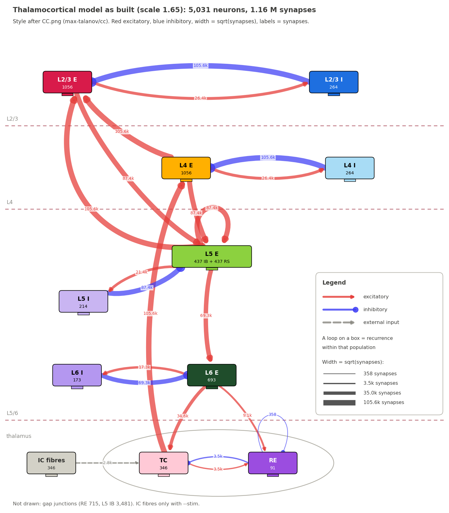

*Connectivity diagram in the style of the cc model's `CC.png`. Red: excitatory,
blue: inhibitory, dashed grey: external input; edge width is the square root of
the synapse count.*

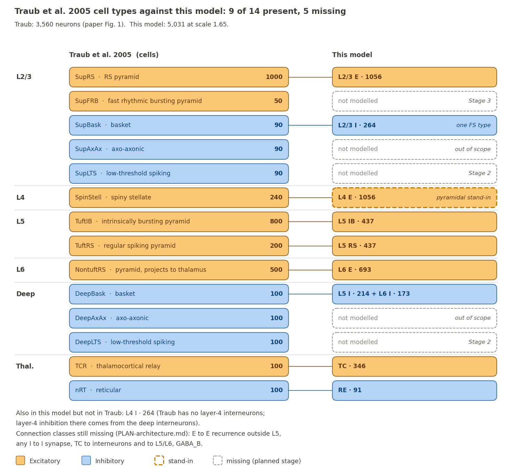

*Cell types of Traub et al. 2005 against the current model (9 of 14 present).*

## 3. Results

### 3.1 Slow oscillation and spindles (spindle plan, Stages 1-3)

Full scale, `SPINDLE=stage2`, noise 200 Hz (`figures/stage3b_noise200_lfp.png`):

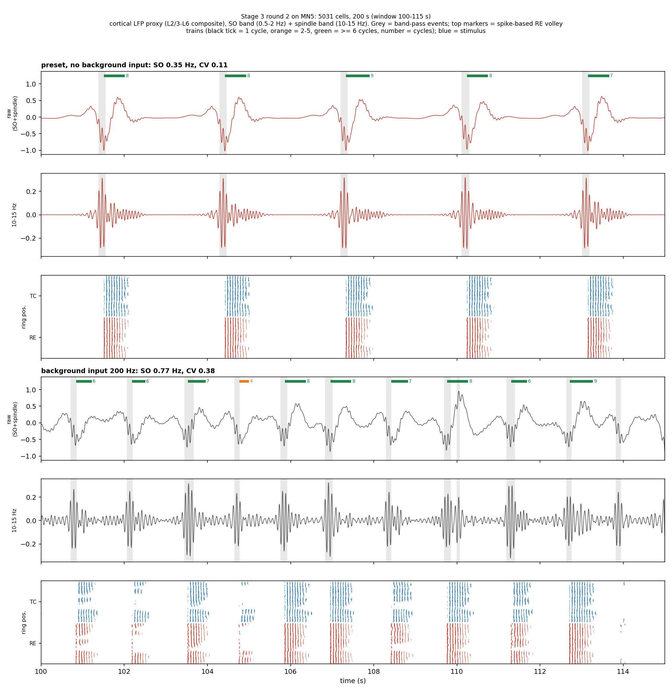

*Full-scale run with background input: irregular SO with spindles in the UP states.*

| Measure | Value |
|---|---|
| SO rate / CV of UP intervals | 0.77 Hz / 0.38 |
| UP states carrying a spindle | 63% |
| Spindle frequency in 10-15 Hz | 93% |
| Spindles waxing/waning | 98% |
| Median spindle length | 498 ms |

K_Na in RE (TRN-side refractoriness): in the isolated thalamus the second
spindle is 40% smaller at 1.5 s and recovers over 4-8 s. It has not yet been run
at full scale, and the C1/C2/C3 runs are without it.

### 3.2 Open-loop tones, C1/C2 (342 tones, 3 seeds, sham-controlled)

Tone vs sham, by SO state at the tone (`figures/c12_phase_final.png`):

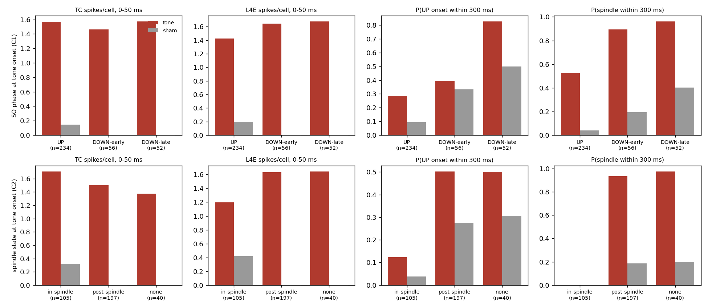

*Tone and sham responses by SO state at the tone (C1/C2, 342 tones).*

| | UP (234) | DOWN-early (56) | DOWN-late (52) |
|---|---|---|---|
| TC spikes/cell, 0-50 ms | 1.57 vs 0.15 | 1.46 vs 0.00 | 1.57 vs 0.00 |
| P(UP onset within 300 ms) | 29% vs 9% | 39% vs 33% (n.s.) | **83% vs 50%** |
| P(spindle within 300 ms) | 53% vs 4% | 89% vs 19% | 96% vs 40% |

By spindle state: a tone during a spindle gives a net L4 response of 0.78
spikes/cell (vs 1.65 outside spindles) and a net L2/3 response of 0.09 (vs 0.29).
By level: TC response is graded (0.8, 1.7, 2.2 spikes/cell at 30, 45, 60 dB),
L4 saturates by 45 dB, and evoked spindles and UP states are nearly all-or-none
even at 30 dB. Without K_Na there is no refractoriness after a spindle.

### 3.3 Closed loop, C3 (3 seeds, stim/sham pairs, 100 ranks)

**Method.** An online detector (50 ms window, 6 Hz/cell, 300 ms refractory)
finds the SO UP volley from the allreduced L5E+L6E spike count. Offline on the
C1/C2 sham runs it finds 92% of UP onsets with no false positives, about 3 ms
after the volley peak. (The plan's original "DOWN = population silence" trigger
cannot work: the cortex never goes silent, 2-3.5 Hz/cell between SOs.) A tone
(45 dB, 50 ms) is queued at a delay d drawn from {0, 200, ... 1000} ms after
every second detection. The sham arm runs the same detector and draws, and plays
nothing.

**Checks.** All three sham runs are bit-identical to the plain runs
(10,878,981 / 11,325,188 / 9,981,672 spikes) on 100 ranks. Wall time was about
1,190 s per run (one sham run, seed 0, logged 3,203 s, probably a slow node).
The stim arms played 153 / 155 / 132 tones from 305 / 310 / 263 detections.

**Results** (439 stim tones vs 404 sham fake tones;
`figures/c3_closed_loop_vs_delay.png`):

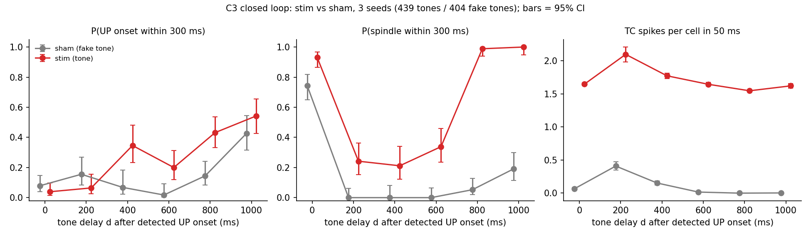

*C3, stim (red) vs sham (grey) against the tone delay d after the detected UP
volley; bars are 95% confidence intervals.*

| d (ms) | P(UP within 300 ms) | P(spindle within 300 ms) | TC spikes/cell, 50 ms |
|---|---|---|---|
| 0 | 4% vs 8% (n.s.) | 93% vs 74% | 1.65 vs 0.07 |
| 200 | 6% vs 16% (n.s.) | 24% vs 0% | 2.10 vs 0.41 |
| 400 | **35% vs 7%** | 21% vs 0% | 1.77 vs 0.15 |
| 600 | **20% vs 2%** | 34% vs 0% | 1.64 vs 0.02 |
| 800 | **43% vs 14%** | 99% vs 5% | 1.55 vs 0.00 |
| 1000 | 54% vs 43% (n.s.) | 100% vs 19% | 1.62 vs 0.00 |
| all | 26% vs 15% | 68% vs 23% | 1.70 vs 0.09 |

Whole-run effect on the SO (stim vs sham, seeds 0/1/2): UP rate 0.80/0.81/0.74
vs 0.74/0.78/0.68 Hz; CV of UP intervals unchanged (0.37-0.45); spindle rate
0.57/0.59/0.55 vs 0.49/0.48/0.43 Hz; spindles per UP 0.50/0.53/0.56 vs
0.66/0.61/0.63. So the tone adds UP and spindle events, and the UPs it
triggers carry fewer spindles. The 99-100% spindle probability at d = 800-1000
ms is partly tone-driven TC bursting, not a natural spindle.

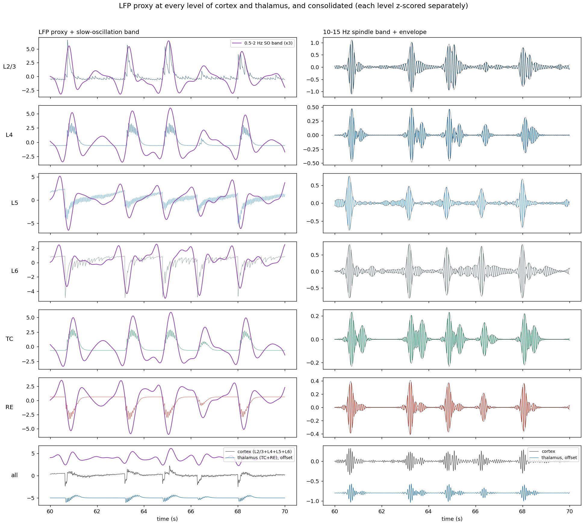

*LFP proxy of every cortical level and of the thalamus in an unstimulated
(sham) run, for orientation before the tone-locked figures below.*

## 4. Tools built for Edo's experiments

Edo's request (two pages): vary SO phase at the stimulus (rising, peak, falling,
trough), spindle present or absent and its phase relative to the SO, one or two
stimuli, duration and intensity; measure tone-locked field potentials and cell
activity, SO power, P(spindle), spindle power and spindle phase after the
stimulus, shown as Graph A (SO phase at stimulus by spindle-to-SO phase,
colour = effect). Plan: `PLAN-stimulation-experiments.md`.

### 4.1 Offline analysis (WP2, done)

| Script | What it does |
|---|---|
| `neuron/stim_phase.py` | SO phase (cortical E rate, 0.3-1.5 Hz, Hilbert; 0 deg = UP-state maximum), causal phase estimator, spindle state from RE volley trains, per-tone 1 s responses, Graph A grid, two-level bootstrap CIs (seeds, then tones), Rayleigh test |
| `neuron/stim_erp.py` | Tone-locked LFP proxies of L2/3, L4, L5, L6, TC and RE, by SO phase and spindle state |
| `neuron/stim_psth.py` | Tone-locked population rates of the 10 cell types |
| `neuron/test_stim_phase.py` | 23 unit tests on synthetic data, all passing |

Validation on the three C3 sham runs:

- UP-state peaks fall at about -47 deg (resultant length 0.80-0.86), so the
  phase convention is sound.
- Spindle peaks lock to the SO peak (-6 to -20 deg, resultant length 0.96) and
  occupy 26-28% of the time. **Consequence:** with natural spindles, Graph A's
  spindle-phase axis fills mainly near "peak"; only stimulus-evoked spindles can
  populate the other cells.
- **Causal phase estimate.** The arms diverge after the first tone, so each arm
  is classified from its own pre-tone data (an acausal filter would leak the
  tone's response). Median error 23-25 deg, 61-66% of tones in the correct
  90-degree bin; trough tones are often called rising (185 of 456), because
  the DOWN-to-UP transition is unpredictable. A longer filter was worse (56 deg,
  41%).

First results on the C3 data (`figures/stim_graph_a_c3.png`,
`stim_erp_c3_*.png`, `stim_psth_c3_*.png`; only 6 of 20 Graph A cells have 5 or
more tones in both arms, because C3 tones are timed from UP detection):

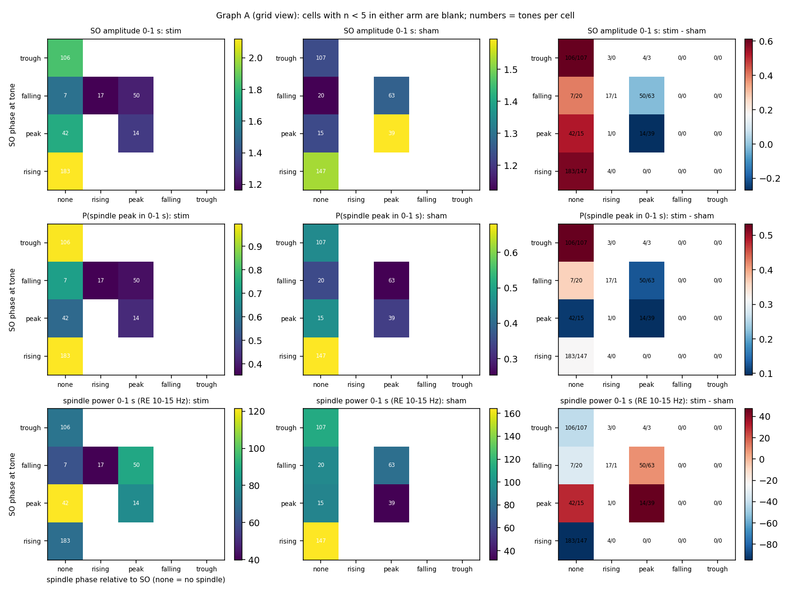

*Graph A in grid form for SO amplitude, P(spindle) and spindle power; `*` marks
cells whose 95% bootstrap CI of stim minus sham excludes 0, numbers are tones
per cell, cells with fewer than 5 tones in either arm are blank.*

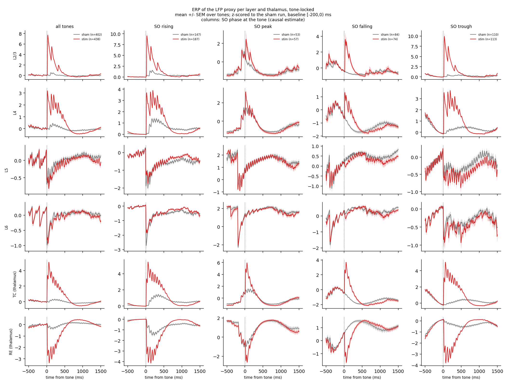

*Tone-locked LFP-proxy ERPs (mean ± SEM over tones), columns: SO phase at the tone.*

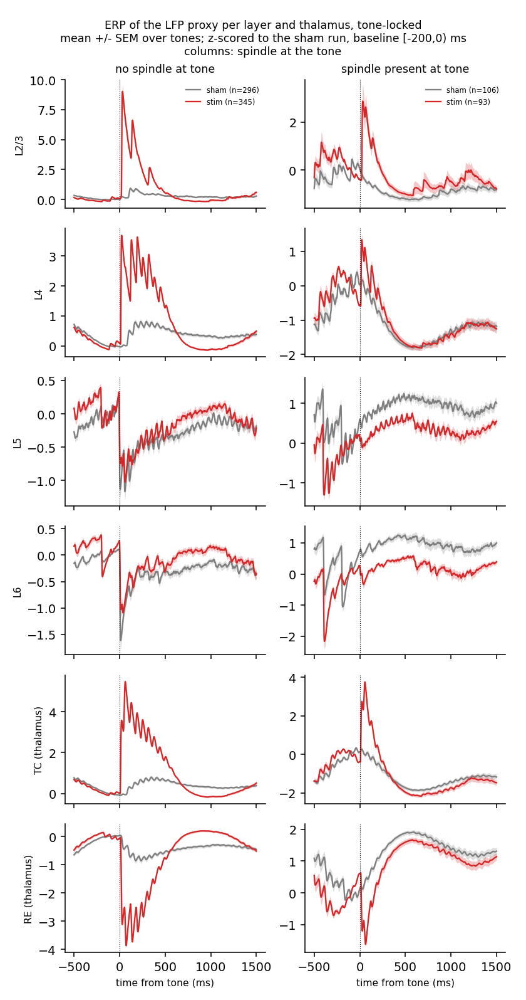

*Same ERPs, columns: no spindle or spindle present at the tone.*

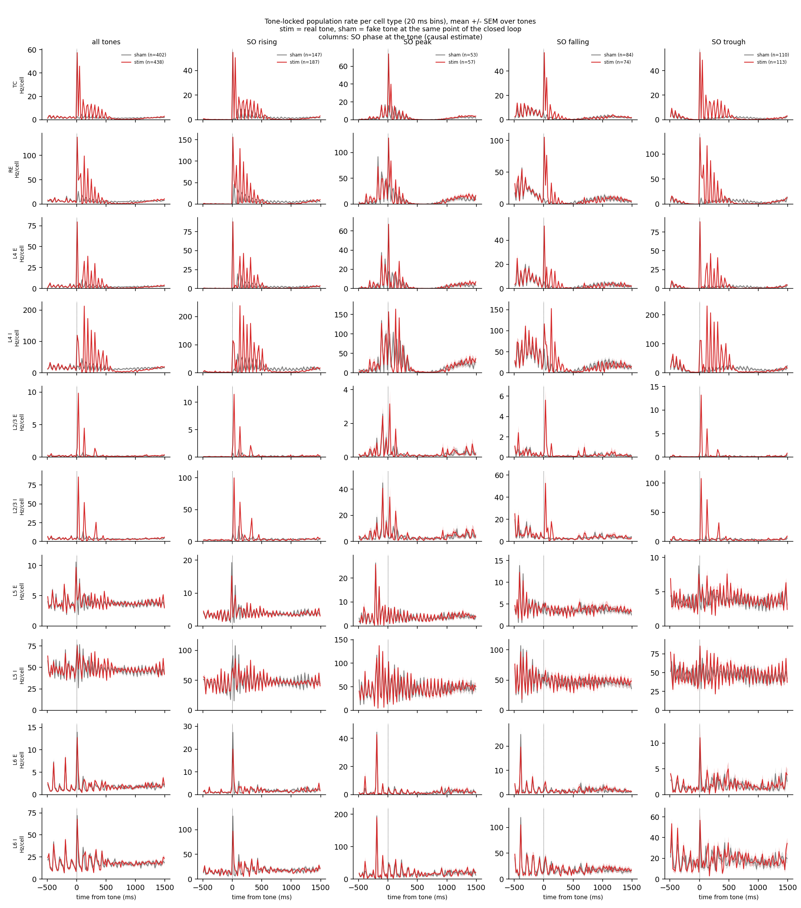

*Per-cell-type PSTHs (20 ms bins), columns: SO phase at the tone.*

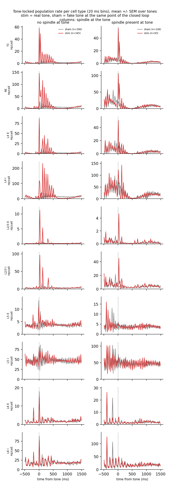

*Per-cell-type PSTHs, columns: spindle state at the tone.*

- Tones at rising and trough phases without a spindle raise SO amplitude
  (+0.59, +0.61) and P(spindle) (+0.31, +0.53); bootstrap CIs exclude 0.
- With a spindle at the SO peak (14 stim, 39 sham tones) the SO amplitude is
  lower with the tone (-0.27, CI excludes 0).
- ERPs: large tone responses in L2/3 (about 8-10 SD), L4 (3-4 SD), TC (4-5 SD)
  and RE (-3 to -4 SD, then a 0.5-1 s rebound, the evoked spindle); L5 and L6
  hardly change. The response is much smaller when a spindle is present
  (L2/3 about 3 SD instead of 9) and small at the SO peak.
- PSTHs: one synchronous thalamic volley (TC about 55 Hz/cell, RE about 140
  Hz/cell in 20 ms), then 10-14 Hz ringing in TC, RE and L4 for about 500 ms;
  L4 interneurons reach 200-240 Hz/cell; L2/3 fires one or two volleys; L5
  and L6 are unchanged.
- **Unexplained:** at rising and trough phases the tone raises P(spindle) but
  lowers RE spindle-band power (-95, -42; CIs exclude 0). Probably the
  evoked spindle is shorter in the 10-15 Hz band than a natural one; not
  checked. Until it is, spindle power (M5) should not be read alone.

### 4.2 Simulator (WP3, done)

`--open-loop {stim,sham}` (`neuron/closed_loop.py`: `tone_schedule`,
`run_open_loop`): tones 5-9 s after the end of the previous one (the spindle
refractory period is 4-8 s); per tone the number of stimuli (1 or 2, the second
`--ol-isi` ms later, default 1075), the duration and the level are drawn from
lists, so one run covers every factor combination at random SO phase. The
schedule is deterministic in `--ol-seed`, so stim and sham share it. All stimuli
are queued after `finitialize` and the run is a single `psolve`, so sham is
bit-identical to a plain run. Checked locally (scale 0.1, 60 s, one rank): sham
equals plain (228,911 spikes), stim plays 12 stimuli for 7 tones. The multi-rank
check is the first item of E0.

## 5. Status and next steps

| Step | State |
|---|---|
| Model, SO, spindles | done; K_Na at full scale pending |
| Sound input, C1/C2 | done, sham-controlled |
| C3 closed loop | done, analysed |
| Edo experiments, WP0 (definitions) | open, needs Edo (section 6) |
| WP1 / E0: dose-response, 8 jobs | **prepared, not yet submitted** (`MN5_NEURON.md`, "Stimulation experiments") |
| WP2 analysis, WP3 simulator | done |
| E1 reference (16 seeds) and E2 one-factor sweeps | after E0; about 55 node-hours for E0-E2 together |
| Thalamic LFP proxy definition | open |
| Wake state (Stage B), plasticity | not started / parked |

E0 (4 seeds, levels 25-75 dB, one 50 ms stimulus) decides the intensity range
for everything after it. If the thalamus saturates, the next levers are a
stronger K_Na at full scale and a lower IC-to-TC weight.

## 6. Questions for Edo

1. Phase convention: is "peak" the maximum of UP-state activity (the proposal
   here), and how should the model's LFP polarity map onto the experiment?
2. Inter-stimulus interval for the two-stimulus condition (1,075 ms assumed).
3. The 0-1 s window holds less than one SO cycle, so spectral SO power is poorly
   estimated. Is SO-band amplitude acceptable, with a 0-2 s check?
4. The reference for "Hongi's paper", to match the ERP layout.
5. Duration and intensity levels (25-200 ms and 25-75 dB are the proposal).

## 7. Caveats

- All stimulation results above come from one configuration (no K_Na, 45 dB,
  three seeds) with an over-excitable thalamus. They show the direction of the
  effects, not calibrated sizes.
- Thalamic traces are spike-based proxies, not measured fields. LFP proxies are
  z-scored to the sham run of the same seed.
- The cortical-layer LFP spindle band is partly filter ringing; spindles are
  counted from RE spikes.
- Graph A is sparse with natural spindles (section 4.1), and the C3 tone timing
  leaves most cells empty. Random open-loop tones (WP3) sample phases more
  evenly, but the single-cell power of the full spindle-phase grid will still be
  low at about 900 tones; the plan lists coarser bins and more seeds as fixes.
- Docs still cite local `res/` tables that are not in the repository.

## 8. Where things are

| What | Where |
|---|---|
| Plans | `PLAN-spindels.md`, `PLAN-auditory-input.md`, `PLAN-architecture.md`, `PLAN-stimulation-experiments.md` |
| MN5 recipes | `MN5_NEURON.md` (C3 closed loop; stimulation experiments and E0) |
| Model | `neuron/ctx_thalamus_mpi.py`, `neuron/auditory_input.py`, `neuron/closed_loop.py` |
| Analysis | `neuron/cl_analyze.py`, `neuron/stim_phase.py`, `stim_erp.py`, `stim_psth.py`, `neuron/ctx_analyze.py` |
| Figures | `figures/` |
| Key commits | `5b00556` C3 closed loop, `1b6a15f` C3 figure and Edo plan, `59c459f` / `c7d9ef8` WP2, `862d9f8` / `08bcf67` ERPs and PSTHs, `bb7fb9b` WP3 |
