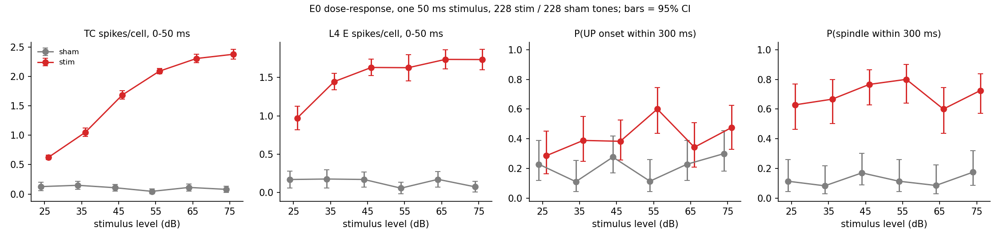
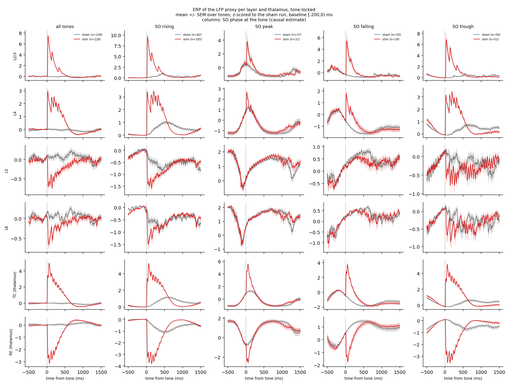
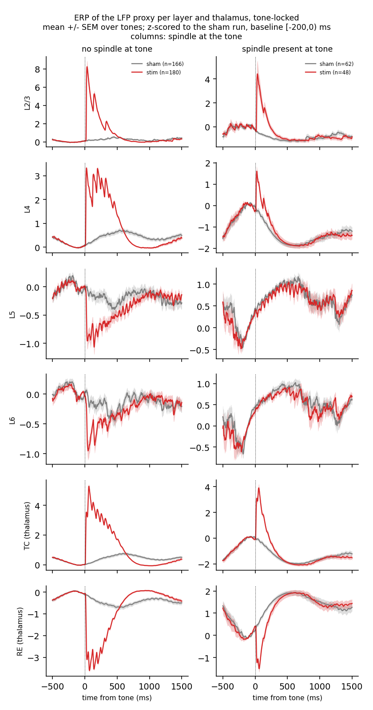
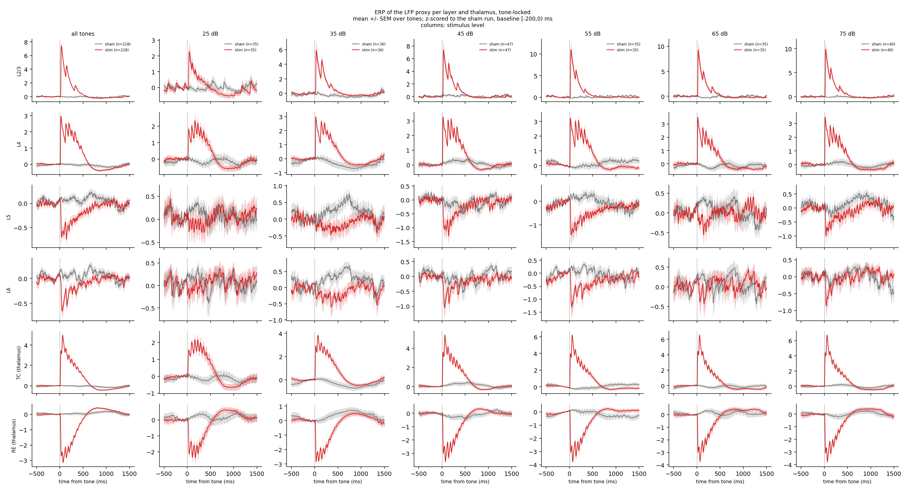
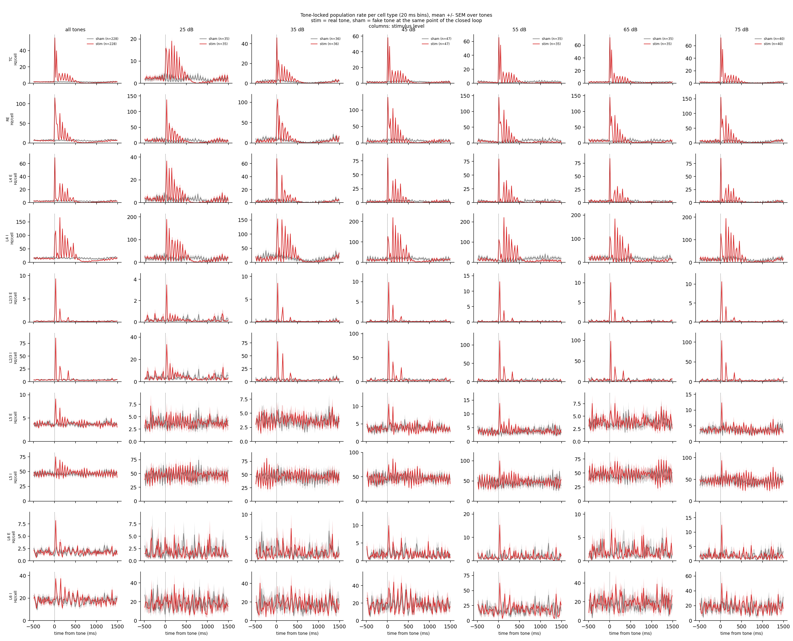
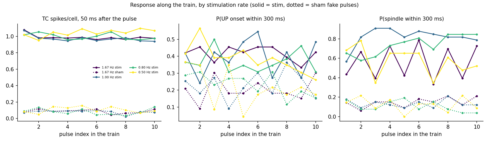
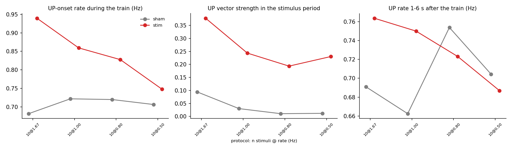

# Comparison of stimulation: cortical response with and without a stimulus, and stimulation rates from the literature

Report of 23 October 2026. It follows `REPORT-2026-10-20.md` and covers the two
questions of the current focus:

1. how the cortical (and thalamic) response, including field potentials,
   differs with and without stimulation;
2. how different stimulation frequencies found in the sleep-stimulation
   literature compare in the model.

Part 1 has results (the E0 dose-response batch, finished 22 October). Part 2 is
designed, implemented and tested on synthetic data, but **not yet run on the
cluster**. File paths are relative to the repository root.

## 1. Summary

- **Stimulus vs no stimulus works as a controlled comparison.** Every stim run
  has a sham run with the same network, seed and tone schedule and no sound. On
  100 ranks the sham runs of seeds 0-2 are bit-identical to the earlier plain
  runs, so the sham is the undisturbed network.
- **Field potentials.** A 50 ms stimulus produces a large, fast response in the
  LFP proxies of L2/3 (peak 7-10 SD at mid levels), L4 (about 3 SD), TC (4-7 SD)
  and RE (a dip of -3 to -4 SD followed by a rebound at 0.8-1 s). L5 and L6
  change little: a short dip of about -1 SD, only at rising and trough phases,
  and only without a spindle.
- **Cell types.** One synchronous thalamic volley (TC 50-70 Hz/cell, RE 100-150
  Hz/cell in 20 ms), then 10-14 Hz ringing in TC, RE and L4 for about 500 ms.
  L4 interneurons reach 200 Hz/cell and L2/3 fires one or two volleys. L5 and L6
  barely respond.
- **State dependence.** The response is largest when the stimulus arrives at
  rising, falling or trough phases and small at the SO peak. With a spindle
  already present the L2/3 response is about half (4.5 vs 8 SD) and the L5/L6
  response disappears.
- **Dose-response.** TC response is graded with level (0.62 to 2.38 spikes/cell
  from 25 to 75 dB), L4 saturates near 45 dB and L2/3 near 55 dB. The
  evoked-spindle probability is 60-80% at every level (sham 13%) and the UP
  probability is not graded: the thalamus is too excitable to calibrate with
  level alone.
- **Frequencies from the literature** (0.8 Hz rhythmic, 1 Hz blocks,
  phase-locked pairs, 5- and 10-click trains, single stimuli with pauses) are
  summarised in section 5. The F1 batch (10-pulse trains at 0.5, 0.8, 1.0 and
  1.67 Hz, 7 seeds) shows that stimulation locks UP onsets to the pulses at
  every rate, more strongly and with more UP states at higher rates (R 0.38 and
  0.94 UP/s at 1.67 Hz vs R 0.23 and 0.75 at 0.5 Hz; sham 0.1 and 0.7). The
  lock at the model's own SO rate (0.8 Hz) is the weakest, the response does not
  fade along the train, and there is no clear effect 1-6 s after it.

## 2. Methods in brief

| Item | Value |
|---|---|
| Model | NEURON corticothalamic network, 5,031 cells (scale 1.65), 100 MPI ranks, 400 s per run in about 1,190 s |
| Configuration | the C1/C2/C3 configuration (`SPINDLE=stage2`, `--cx-noise-rate 200`), no K_Na |
| Stimulus | IC fibres onto TC cells, 50 ms, level as stated; schedule deterministic in `--ol-seed` and independent of rank count |
| E0 batch | `--open-loop`: one stimulus per tone, level drawn per tone from 25, 35, 45, 55, 65, 75 dB, tones 5-9 s apart; 4 seeds x (stim, sham) = 8 jobs, 227 tones per arm |
| Sham | the same schedule with no sound; the stim arm diverges from the sham after its first tone |
| SO phase | cortical E rate, 0.3-1.5 Hz, Hilbert phase, 0 = UP-state maximum; bins rising / peak / falling / trough; estimated **causally** (median error 25 deg, 64% of tones in the correct bin) because the arms diverge |
| Spindle | RE volley train, at least 6 volleys; "present" if the last volley is within 150 ms and at least 3 volleys have occurred |
| Field potentials | spike-based LFP proxies (population spikes convolved with a PSP kernel, deep layers and RE sign-flipped), z-scored to the sham run of the same seed, baseline [-200, 0) ms. TC and RE are proxies, not measured fields |
| Statistics | Wilson 95% CIs for probabilities, SEM over tones for traces, Fisher and Mann-Whitney tests |

The sham checks of the E0 batch: all four sham runs equal the earlier plain
runs where those exist (seeds 0-2, bit for bit), schedules are identical between
stim and sham, wall times were 1,179-1,450 s (seed 0 sham, 1,450 s, was
probably a slow node). Two earlier submissions failed at start-up because the
new code had not reached MN5 (the first the missing `closed_loop.py`, the
second a stale `ctx_thalamus_mpi.py`); both cost seconds, not results.

## 3. Part 1: the cortical response with and without a stimulus

### 3.1 Dose-response

*Figure 1. E0, one 50 ms stimulus, 228 stim and 228 sham tones. Bars are 95% CIs.*

| level (dB) | n | TC spikes/cell (50 ms), stim vs sham | L4 E spikes/cell | P(UP within 300 ms) | P(spindle within 300 ms) |
|---|---|---|---|---|---|
| 25 | 35 | 0.62 vs 0.13 | 0.97 vs 0.17 | 29% vs 23% (n.s.) | 63% vs 11% |
| 35 | 36 | 1.05 vs 0.15 | 1.45 vs 0.18 | 39% vs 11% (p 0.013) | 67% vs 8% |
| 45 | 47 | 1.69 vs 0.11 | 1.63 vs 0.17 | 38% vs 28% (n.s.) | 77% vs 17% |
| 55 | 35 | 2.09 vs 0.05 | 1.63 vs 0.06 | 60% vs 11% (p < 0.001) | 80% vs 11% |
| 65 | 35 | 2.31 vs 0.11 | 1.74 vs 0.17 | 34% vs 23% (n.s.) | 60% vs 9% |
| 75 | 40 | 2.38 vs 0.08 | 1.73 vs 0.08 | 48% vs 30% (n.s.) | 72% vs 18% |
| all | 228 | 1.70 vs 0.10 | 1.53 vs 0.14 | 41% vs 21% | 70% vs 13% |

TC and L4 responses differ from sham at every level (p < 0.001). TC keeps rising
up to 75 dB, L4 is flat from 45 dB. The spindle probability is high from the
lowest level and its CIs overlap across levels, so spindles are close to
all-or-none; the UP probability is noisy and not graded. This repeats the C1/C2
finding and now covers a lower range (25 dB).

### 3.2 Field potentials by SO phase

*Figure 2. Tone-locked LFP proxies, mean +/- SEM over tones. Columns: all tones
and the SO phase at the tone. Counts (sham/stim): rising 82/105, peak 37/31,
falling 50/39, trough 58/52.*

- Sham shows the natural SO waveform at each phase; the stimulus adds a response
  on top of it.
- L2/3 peaks at about 10 SD (rising), 7 (trough) and 5 (falling). At the SO peak
  the added response is small (about 4 SD above a baseline already rising).
- L4 (about 3 SD) and TC (4-5 SD) respond at every phase.
- RE dips by -3 to -4 SD at rising and trough phases and rebounds after about
  0.8 s, the thalamic signature of the evoked spindle.
- L5 and L6 deflect by about -1.5 SD at rising phase, about -0.5 at trough, and
  barely at the peak and falling phases.

### 3.3 Field potentials with and without a spindle

*Figure 3. Left: no spindle at the tone (166 sham, 180 stim). Right: spindle
present (62 sham, 48 stim).*

With a spindle present the L2/3 peak is about 4.5 SD instead of 8, the L4 peak
about 1.3 instead of 3, the TC response is smaller and shorter, the RE dip is
-1.5 instead of -3.5 SD, and L5 and L6 show **no** stimulus-locked change. This
matches the C1/C2 result (net L4 response down about 50% and L2/3 down 65%
during a spindle). Whether the stimulus also interrupts the spindle, as reported
for human data (section 5), has not been analysed yet.

### 3.4 Field potentials by level

*Figure 4. Columns: all tones and the six levels, 35-47 tones per arm each.*

L2/3: about 2 SD at 25 dB, 6 at 35 dB, 7 at 45 dB, 10-11 at 55 dB and no further
growth at 65 and 75 dB. L4: 2 SD at 25 dB and about 3 SD from 35 dB. TC: 2 SD
at 25 dB, 6-7 SD at 65-75 dB. RE: -2 SD at 25 dB, -3 to -4 SD from 45 dB. L5 and
L6 show nothing at 25-35 dB and a short dip of about -1 SD from 45 dB. So the
field potentials are graded between 25 and about 55 dB and saturate above. The
intensity range 25-55 dB covers the whole dynamic range; the spindle probability
saturates before the field potentials do.

### 3.5 Cell types

*Figure 5. PSTHs (20 ms bins) of TC, RE and the E and I populations of L4, L2/3,
L5 and L6, by level; stim in red, sham in grey.*

- **Thalamus and L4.** At 25 dB TC, RE and L4 respond with a prolonged 10-14 Hz
  oscillation (TC peaks of 15-19 Hz/cell for about 500 ms) rather than one
  sharp volley. From 35 dB the first volley dominates (TC 45-70 Hz/cell, RE
  100-150 Hz/cell) and is followed by smaller ringing cycles.
- **L4 interneurons** reach 150 Hz/cell at 35 dB and about 200-220 Hz/cell from
  45 dB, much higher than the L4 excitatory rate (70-85 Hz/cell peak).
- **L2/3** fires one main volley (3.5 Hz/cell at 25 dB up to 13 Hz/cell at 55
  dB), with one or two smaller ones; L2/3 interneurons follow (about 30 to 110
  Hz/cell).
- **L5 and L6** respond weakly and only from 45 dB (L5 E about +4-7 Hz/cell,
  L6 E about +6-12 Hz/cell above their baseline at the first bin); L5 inhibitory
  cells keep their 13 Hz ripple in both arms.

The same figure split by SO phase and by spindle state is `figures/e0_psth_by_so_phase.png`
and `figures/e0_psth_by_spindle.png`; the tone-locked LFP and PSTH figures of
the earlier closed-loop batch are `figures/stim_erp_c3_*.png` and
`figures/stim_psth_c3_*.png`.

### 3.6 What part 1 says

Stimulation produces a fast, strong response in thalamus, L4 and L2/3 that
depends on SO phase and is cut by an ongoing spindle, a delayed RE rebound that
marks the evoked spindle, and almost nothing in the deep layers. The cortical
response is graded between 25 and 55 dB. What does not match a graded dose
response is the all-or-none spindle and UP probability, which points to the
thalamic excitability, not to the level range, as the quantity to tune.

## 4. Open problems in part 1

- **The thalamus is too excitable.** 63% of the lowest-level stimuli already
  evoke a spindle, and the evoked-spindle probability does not grow with level,
  so level cannot be used to tune the response. The next levers are a stronger K_Na (validated only in the
  isolated thalamus), a lower IC-to-TC weight, and levels below 25 dB.
- **Single configuration.** All results use one parameter set, 3-4 seeds, no K_Na.
  They show the direction of effects, not calibrated sizes.
- **Proxies.** TC and RE traces are spike-based; the LFP proxies are z-scored to
  sham. The cortical spindle band is partly filter ringing, so spindles are
  counted from RE spikes.
- **Spindle power.** In the closed-loop batch the stimulus raised the spindle
  probability but lowered RE spindle-band power at some phases; not explained.

## 5. Part 2: stimulation rates in the literature

What was confirmed in the sources found; the rest is marked.

| Protocol | Source | Rate / structure |
|---|---|---|
| Rhythmic, fixed rate | Ngo et al. 2013 (J Sleep Res), [arXiv 1407.7999](https://ar5iv.labs.arxiv.org/html/1407.7999) | 0.8 Hz tones, compared with random tones and sham; entrains SO once sleep is established, delays sleep onset if started before sleep |
| Rhythmic, blocks | Tononi group (Bellesi et al. 2014), described in [Frontiers 2017](https://www.frontiersin.org/journals/human-neuroscience/articles/10.3389/fnhum.2017.00109/text) | 50 ms tones at a fixed 1 Hz, 15-tone blocks alternating with silence |
| Phase-locked pair | Ngo et al. 2013 (Neuron) | clicks in phase with the SO up state enhance SO, spindles and memory, out of phase ineffective; the 1.075 s click interval is **not verified** |
| More than two clicks | Ngo et al. 2015 (J Neurosci), as cited in [Debellemanière et al. 2022](https://pmc.ncbi.nlm.nih.gov/articles/PMC9788124) | little added benefit beyond two clicks, attributed to a refractory period, especially for fast spindles |
| 5-click sequence | Papalambros et al. 2017, same citation | benefit for SO and fast spindles for each click |
| 10-click trains at the SO rate | Debellemanière et al. 2022 | first click closed-loop, the rest at a fixed interval matched to the subject's mean SO frequency; 10 s pause per train |
| Single stimuli | Koller et al. 2025 ([bioRxiv](https://www.biorxiv.org/content/10.1101/2025.03.04.639851.full.pdf)) | one 286 ms sound at the SO negative-to-positive transition, 4.5 s pause; SO and delta rise, **fast spindles fall**, partly because the sound interrupts spindles; the response to later pulses "quickly fades out" |

"Hongi's paper" in Edo's note is probably by Hong-Viet Ngo (not confirmed).
Koller et al. use ERP epochs of -1.5 to 3.5 s.

**What the model can compare.** The model's SO runs at 0.77 Hz (period about 1.3
s). So 0.8 Hz is nearly resonant, 1 Hz drifts through all phases, 0.5 Hz is
slower than the SO and 1.67 Hz about twice as fast. Four literature claims map
onto four measures:

| Literature claim | Measure in the model (`neuron/stim_train.py`) |
|---|---|
| rhythmic stimulation near the SO rate entrains the SO | vector strength of UP-onset times in the stimulation period, with a Rayleigh test, stim vs sham |
| the response to later pulses fades (refractory period) | TC response, P(UP) and P(spindle) by pulse index within the train |
| no lasting effect after the train | UP and spindle rate 1-6 s after the train, stim vs sham |
| fast spindles are depressed | spindle rate during and after the train; spindle continuation after a stimulus (not yet implemented) |

### F1 design

- 50 ms stimuli at 35 dB (TC response about 1 spike/cell, in the graded range of
  figure 1);
- trains of n = 1 (the single-stimulus reference, as in Koller et al.) or n = 10
  (as in Debellemanière et al.);
- rates 0.5, 0.8, 1.0 and 1.67 Hz (`--ol-isi 2000:1250:1000:600`), drawn per
  train, with 5-9 s between the end of a train and the next;
- 8 seeds x (stim, sham) = 16 jobs of about 20 minutes;
- recipe, upload and checks in `MN5_NEURON.md` ("F1 frequency comparison").

Run on MN5 on 100 ranks (jobs 47997979-47997993, 1,170-1,210 s each, one sham
run 1,442 s). 15 of 16 files came back: the seed-0 stim test job stayed in the
queue for days and was skipped, so the analysis uses seeds 1-7 (7 pairs, 23-33
trains of n = 10 per rate). Each stim run has 29-35 trains and 152-204 stimuli,
and the stim and sham schedules are identical. The sham runs of seeds 0-2 are
bit-identical to the earlier plain runs. The n = 1 trains are not analysed here.

### F1 results

Stim vs sham, n = 10 trains (sham uses the same pulse times without sound):

| Rate | Trains | UP onsets/s in train | UP vector strength R | UP/s 1-6 s after | spindles/s 1-6 s after |
|---|---|---|---|---|---|
| 1.67 Hz | 33 | 0.94 vs 0.68 | 0.38 (p < 0.001) vs 0.09 (p = 0.30) | 0.76 vs 0.69 | 0.50 vs 0.43 |
| 1.00 Hz | 32 | 0.86 vs 0.72 | 0.24 (p < 0.001) vs 0.03 (p = 0.81) | 0.75 vs 0.66 | 0.51 vs 0.41 |
| 0.80 Hz | 26 | 0.83 vs 0.72 | 0.19 (p < 0.001) vs 0.01 (p = 0.97) | 0.72 vs 0.75 | 0.48 vs 0.46 |
| 0.50 Hz | 23 | 0.75 vs 0.71 | 0.23 (p < 0.001) vs 0.01 (p = 0.96) | 0.69 vs 0.70 | 0.46 vs 0.43 |

What it shows:

- **Stimulation locks UP onsets to the pulses at every rate.** Vector strength is
  significant for stim and not for sham at all four rates.
- **The faster the rate, the stronger the lock and the more UP states.** At 1.67
  Hz the UP rate in the train rises from 0.68 to 0.94 per second; at 0.5 Hz it
  barely changes (0.71 to 0.75). The model's own SO rate is 0.77 Hz, so the
  expected resonance at 0.8 Hz is **not** seen: 0.8 Hz has the weakest lock.
  Part of the high-rate effect is that a pulse every 0.6 s has more chances to
  start an UP state within 300 ms; the table does not separate this from true
  rhythm entrainment.
- **No fading along the train.** The TC response is flat across pulses 1-10 at
  every rate (about 1.0 spikes/cell, sham 0.1). The literature reports fading
  (refractoriness, Ngo 2015, Koller 2025); the model does not show it, which fits
  the over-excitable thalamus found in E0. P(UP) and P(spindle) per pulse are
  noisy (23-33 trains per point) with no clear trend, and sit above sham
  throughout (P(spindle) 0.35-0.9 vs 0.1-0.2).
- **No clear lasting effect.** UP and spindle rates 1-6 s after the train differ
  from sham by a few hundredths to a tenth per second, in both directions (UP at
  0.8 and 0.5 Hz is slightly below sham). No confidence intervals are computed
  for these rates, so none of these differences should be read as an effect.
- **Fast spindles are not depressed** in this measure: the spindle rate after the
  train is equal to or above sham. The spindle-interruption measure (does a
  stimulus end an ongoing spindle?) is still not implemented, so this claim is
  open.

Limits: seed 0 is missing; the rates have no bootstrap confidence intervals;
the vector-strength comparison is between stim and the sham clock, not between
rates; the pulses are not phase-locked to the SO (open loop).

## 6. Next steps

1. Add bootstrap confidence intervals to the F1 rates, seed 0, and the n = 1 trains; phase-locked trains.
2. Reduce the thalamic excitability (K_Na at full scale, IC-to-TC weight, levels
   below 25 dB) and repeat E0, since stimulation rate comparisons depend on it.
3. Add the spindle-interruption measure (does the stimulus end an ongoing
   spindle?) and a shorter-window version of the phase-by-spindle graph.
4. Answers from Edo: phase convention, the second stimulus interval, ERP layout
   (which paper), and the duration and intensity levels (`PLAN-stimulation-experiments.md`,
   open questions).

## 7. Where things are

| What | Where |
|---|---|
| E0 analysis | `neuron/stim_dose.py`, `neuron/stim_erp.py`, `neuron/stim_psth.py` (`--split level`) |
| Train analysis | `neuron/stim_train.py`, tests `neuron/test_stim_train.py` and `neuron/test_stim_phase.py` |
| Simulator | `neuron/closed_loop.py` (`tone_schedule`, `run_open_loop`), `neuron/ctx_thalamus_mpi.py` (`--open-loop`, `--ol-*`) |
| Recipes | `MN5_NEURON.md` (E0, F1) |
| Plan | `PLAN-stimulation-experiments.md` (section 9: rates from the literature) |
| Figures | `figures/e0_*.png`, `figures/f1_*.png` |
| Commits | `bb7fb9b` (open-loop mode), `acdff0f` (E0 analysis and rate tools) |
