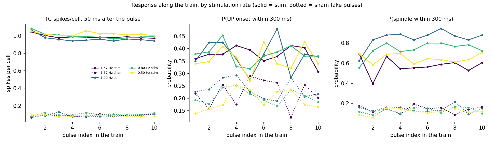
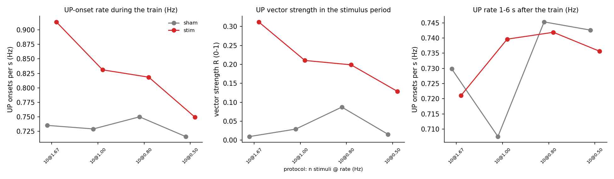

# Progress report, 10 November 2026

Corticothalamic sleep model (NEURON, MPI, MareNostrum 5): the sound-stimulation
comparisons run since the report of 23 October, mainly the stimulation-rate
experiments (F1 and F2). Earlier results are in
`reports/REPORT-2026-10-20.md` and
`reports/REPORT-2026-10-23-stimulation-comparison.md`, which also holds the full
tables, figures and the literature table.

File paths are relative to the repository root. Raw MN5 outputs stay on disk
(`res/` is git-ignored); numbers from them are quoted here.

## 1. Summary

- **Stimulus vs no stimulus (E0, reported on 23 October).** A 50 ms stimulus
  gives a graded field-potential response in L2/3, L4, TC and RE, large at rising,
  falling and trough phases and small at the SO peak, about half as large when a
  spindle is already present. L5 and L6 barely respond. The thalamus is over-excitable
  (evoked-spindle probability 60-80% at every level, sham 13%).
- **Stimulation rates (F1, F2, new).** Trains of 10 stimuli at 0.5, 0.8, 1.0 and
  1.67 Hz, each run with a sham arm (same network, seed and pulse times, no sound).
  Stimulation locks the start of UP states to the pulses at every rate; the lock
  and the extra UP states per second both grow with the rate. The model's own SO
  runs near 0.8 Hz, so the sham arm is already weakly locked there and 0.8 Hz
  shows no extra resonance.
- **No fading, no lasting effect.** The thalamic response stays at about 1
  spike/cell from the first to the tenth pulse at every rate (the literature reports
  fading), and activity 1-6 s after a train is within noise of sham.
- **Statistics.** About 110 trains per rate over 8 seeds with two-level bootstrap
  intervals (seeds, then trains), so the key differences are now resolved.

## 2. What was run since 23 October

| Batch | Design | Result |
|---|---|---|
| F1 (27 October) | 400 s per run, trains of n = 1 or 10, rates 0.5-1.67 Hz, 8 seeds x (stim, sham); 15 of 16 files returned (seed-0 stim job stayed in the queue and was skipped) | 23-33 n = 10 trains per rate on 7 seeds; effects visible, intervals wide |
| F2 (10 November) | 1,200 s per run, n = 10 only, 8-12 s between trains, 8 seeds x (stim, sham), 16 jobs, 3,504-4,363 s wall | 106-117 trains per rate, all 16 files returned, checks passed |

F2 checks: stim and sham schedules identical for all seeds; 54-62 trains and
540-620 stimuli per run; the sham runs of seeds 0-2 match the earlier plain runs
spike for spikes over the first 400 s (seeds 1 and 2 differ only in the last 1-2
spikes at the run-end boundary). The gap between trains is at least 7.95 s, so
the after-train window (1-6 s) no longer reaches the next train; in F1 it could.

New analysis code: `neuron/stim_train.py` (pulse and train rows, UP vector
strength with a Rayleigh test, per-pulse response, post-train rates) and a
two-level bootstrap of the rates (`bootstrap_summary`, added 28 October). Its
4 synthetic tests pass. The recipes are in `MN5_NEURON.md` ("F1" and "F2").

## 3. F2 results

Stim vs sham, 95% bootstrap interval of the difference (* = excludes 0). R is the
vector strength of UP-onset phase relative to the pulse interval: 0 means onsets
fall anywhere in the cycle, 1 means they always start at the same point.

| Rate | Trains | UP/s in train, stim vs sham | difference | R, stim vs sham | difference | after-train UP/s | after-train spindles/s |
|---|---|---|---|---|---|---|---|
| 1.67 Hz | 114 | 0.91 vs 0.74 | +0.18 [0.11, 0.24] * | 0.31 vs 0.01 | +0.30 [0.18, 0.35] * | -0.01 [-0.06, 0.04] | +0.06 [-0.01, 0.14] |
| 1.00 Hz | 106 | 0.83 vs 0.73 | +0.10 [0.05, 0.15] * | 0.21 vs 0.03 | +0.18 [0.11, 0.24] * | +0.03 [-0.05, 0.11] | +0.06 [0.00, 0.12] * |
| 0.80 Hz | 117 | 0.82 vs 0.75 | +0.07 [0.01, 0.13] * | 0.20 vs 0.09 | +0.11 [0.01, 0.19] * | 0.00 [-0.06, 0.06] | +0.02 [-0.04, 0.09] |
| 0.50 Hz | 115 | 0.75 vs 0.72 | +0.03 [0.00, 0.07] | 0.13 vs 0.02 | +0.11 [0.06, 0.14] * | -0.01 [-0.07, 0.06] | -0.01 [-0.06, 0.05] |

Reading:

- **Locking at every rate.** Rayleigh p < 0.001 for stim at all four rates; sham is
  not significant except at 0.8 Hz (R 0.09), where the SO's own period (about 1.3 s)
  stays in step with the 1.25 s clock over ten cycles.
- **Higher rates drive more UP states.** The gain falls from +0.18 UP/s at 1.67 Hz
  to +0.03 at 0.5 Hz. Part of this is that a pulse every 0.6 s has more chances
  to start an UP state within 300 ms; the analysis does not separate that from
  true rhythm entrainment.
- **No fading along the train.** TC response about 1 spike/cell (sham 0.1) from
  pulse 1 to 10; P(spindle) 0.55-0.95 (sham 0.1-0.2) and rising over the first
  pulses at 0.8 and 1.0 Hz; P(UP) flat within noise.
- **No clear after-effect.** All after-train UP/s intervals include 0. After-train
  spindles/s is higher by 0.06 at 1.0 Hz (interval [0.00, 0.12]) and 1.67 Hz
  (not significant); one borderline interval in eight comparisons, uncorrected.
- **Fast spindles are not depressed** by the stimulus in this measure.

## 4. Caveats

- The over-excitable thalamus is the main limit: a response that does not fade
  and an evoked-spindle probability of 60-80% at every level mean that the
  comparison with the human-sleep literature is not yet meaningful. Tuning
  (K_Na at full scale, IC-to-TC weight, levels below 25 dB) should precede more
  runs.
- The vector-strength intervals are biased upward for small samples, since
  resampling repeats phases. Use the Rayleigh tests for "locked or not" and read
  the R intervals as a rough size.
- The trains are open loop: the pulses are not locked to the SO phase, unlike most
  of the literature protocols. The n = 1 trains of F1 were not analysed.
- The spindle-interruption measure (does a stimulus end an ongoing spindle?) and a
  thalamic LFP definition are not implemented.
- The phase estimator is causal and approximate (median error about 25 degrees).
  Edo's questions (phase convention, second-stimulus interval, ERP layout,
  duration and level choices) are still open.

## 5. Next steps

1. Reduce the thalamic excitability and repeat E0, then repeat the F2 comparison
   on the tuned network.
2. Phase-locked trains: first stimulus at the detected SO phase, the rest at a
   fixed rate (Debellemanière-style), and the n = 1 trains.
3. Spindle-interruption measure and a shorter-window phase-by-spindle graph.
4. Answers from Edo to the open questions in `PLAN-stimulation-experiments.md`.

## 6. Where things are

| What | Where |
|---|---|
| Train analysis and bootstrap | `neuron/stim_train.py`, `neuron/test_stim_train.py` |
| Simulator (open-loop trains) | `neuron/closed_loop.py`, `neuron/ctx_thalamus_mpi.py` (`--open-loop`, `--ol-*`) |
| MN5 recipes | `MN5_NEURON.md` ("F1", "F2") |
| Full tables and literature | `reports/REPORT-2026-10-23-stimulation-comparison.md` |
| Figures | `figures/f1_*.png`, `figures/f2_*.png` |
| Commits | `01017d2` (bootstrap), `7bd8cd9` (F2) |
