# Baseline activity and field potentials of the model without stimulation, and comparison with the literature (16 November 2026)

Corticothalamic sleep model (NEURON, MPI, MareNostrum 5): 8 runs of 120 s on 5,031 cells
(scale 1.65, seeds 0-7, 100 ranks), with no auditory input. The runs are bit-identical to the
first 120 s of the sham arms of F2 (`reports/REPORT-2026-11-10.md`), so this is the undisturbed
network that every stimulation experiment is compared with. The recipe is in `MN5_NEURON.md`
("B120"). File paths are relative to the repository root; raw outputs (`res/`) are not in git.

## 1. Summary

- **Slow oscillation:** 0.70 ± 0.07 UP onsets per second, irregular (CV 0.44). This is inside the
  usual range for the slow oscillation (about 0.75 Hz in human recordings, 0.5-1.5 Hz as a band).
- **Spindles:** at 13.8 Hz they are slightly faster than the human mean (12.3 Hz) but inside the fast
  centroparietal range (13-15 Hz). They start at -47° of the slow oscillation, close to the preferred
  phase in the human data (about -20° to -32°). But there are 26 per minute against 1.6-2.3 per minute in the
  intracranial and scalp recordings, they are shorter (0.51 s against 0.70 s), and every one of them is
  locked to the SO (vector strength 0.99), whereas in human scalp EEG only about 10% of spindles
  closely follow an SO. See section 4 for how much of this is the definition.
- **Field potentials:** the cumulative cortical proxy has 32% of its 0.3-40 Hz power in the SO band
  (0.3-1.5 Hz) and 30% in delta (1.5-4 Hz); the thalamic proxy has 56% in the SO band. L4, TC and RE
  are the most SO-dominated traces (82-89%).
- **UP-state onset:** the UP onset is detected from L5 and L6, so those two layers lead by
  construction. After them, L2/3 interneurons (10 ms), RE (22 ms), L2/3 pyramidal cells (66 ms), TC
  (80 ms) and L4 (85-90 ms) follow.
- **Two things that do not look like sleep data:** L5 fires all the time in the DOWN state (L5 E 2.8
  Hz, L5 I 37 Hz) with a tonic 17.5 Hz rhythm, which Chauvette et al. (2010) found only in slices and
  "never ... in vivo in anesthetized or naturally sleeping cats"; and the interneuron rates are high (L5 I
  44 Hz mean, L4 I 15 Hz, L6 I 17 Hz).
- **Firing rates:** the only cortical reference in the eight papers is the mean rate of recorded
  human units, 3.1 ± 0.3 Hz (Andrillon et al. 2011); none gives rates per cell type, so the model's
  rates per group are not compared numerically.

## 2. Methods

Analysis: `neuron/lfp_baseline.py` (3 unit tests in `neuron/test_lfp_baseline.py`). First 2 s of
each run skipped; values are mean ± SD over the 8 runs.

- **LFP proxy** of a trace = its spikes convolved with a PSP kernel (2 ms rise, 100 ms decay;
  `ctx_analyze._synaptic_lfp`), z-scored, with the deep layers (L5, L6) and RE sign-flipped as in the
  earlier composite LFP. The thalamic traces are proxies, not measured fields, and the sign
  convention is a modelling choice.
- **Traces:** the 10 neuron groups (L2/3, L4, L5, L6 excitatory and inhibitory, TC, RE); the 4
  layers (excitatory and inhibitory spikes pooled); and the cumulative traces, the cortical
  composite (mean of the 4 layers), the thalamic composite (mean of TC and RE) and the network
  (mean of the two).
- **Spectra:** Welch, 8 s segments (0.125 Hz resolution), as fractions of the 0.3-40 Hz power. The
  100 ms kernel attenuates 12 Hz about 8-fold, so the sigma-band share of the LFP proxy is
  underestimated; the sigma peak and share are therefore also taken from the population rate in 5 ms
  bins.
- **UP onsets** from the L5 and L6 excitatory rate (`stage2_report.up_onsets`). UP window = 0-300 ms
  after the onset, DOWN window = -400 to -100 ms.
- **Spindles** = RE volley trains of at least 6 volleys with at most 150 ms between volleys
  (`volley_stats.py`). SO phase at the spindle start from the zero-phase SO band (0.3-1.5 Hz) of the
  cortical E rate, 0° = UP maximum.

## 3. Results

Figures: `figures/b120_traces.png` (12 s of all traces), `figures/b120_spectra.png`,
`figures/b120_rates.png`. Full table: `res/2026-11-16/b120_table.txt`.

### 3.1 Slow oscillation and spindles

| Measure | Value (8 runs) |
|---|---|
| UP onsets per s | 0.70 ± 0.07 |
| CV of UP intervals | 0.44 ± 0.06 |
| Spindles per min | 25.8 ± 2.9 |
| Spindle duration (median) | 0.51 ± 0.04 s |
| Cycles per spindle | 8.0 ± 0.9 |
| Frequency inside a spindle | 13.8 ± 0.1 Hz |
| SO phase at spindle start | -47° (0° = UP maximum), vector strength 0.99, n = 406 |

### 3.2 Cumulative and per-layer field potentials

Fraction of the 0.3-40 Hz power:

| Trace | SO 0.3-1.5 | delta 1.5-4 | theta 4-8 | sigma 9-16 | beta 16-40 |
|---|---|---|---|---|---|
| **cortex (cumulative)** | 0.32 ± 0.02 | 0.30 ± 0.02 | 0.12 | 0.08 | 0.12 ± 0.02 |
| **thalamus (cumulative)** | 0.56 ± 0.03 | 0.20 ± 0.03 | 0.03 | 0.09 | 0.05 |
| **network (cumulative)** | 0.39 ± 0.03 | 0.30 ± 0.02 | 0.11 | 0.05 | 0.08 ± 0.01 |
| L2/3 | 0.51 | 0.22 | 0.10 | 0.09 | 0.04 |
| L4 | 0.86 | 0.07 | 0.01 | 0.02 | 0.02 |
| L5 | 0.54 ± 0.08 | 0.17 | 0.02 | 0.02 | 0.21 ± 0.07 |
| L6 | 0.40 | 0.24 | 0.12 | 0.11 | 0.06 |

Each layer and neuron group is in `res/2026-11-16/b120_table.txt`. In short:

- The SO band dominates TC (0.89), L4 I (0.87), L4 E (0.82) and RE (0.83), which follow the UP
  states with a burst and then go quiet.
- L5 has a large share at 16-40 Hz (0.21; L5 I 0.28), which comes from a tonic rhythm with a peak at
  17.5 Hz that runs all the time between UP states (visible in the traces).
- L2/3 and L6 have the most theta and sigma power (0.10-0.12 and 0.09-0.14).
- The thalamic spectrum has the sharpest SO band of all traces, and the cumulative cortical spectrum
  is the flattest, since layers with different timing partly cancel.
- Population-rate spectra (5 ms bins): the highest peak between 5 and 30 Hz is at about 16 Hz in L4,
  TC and RE (the spindle volleys), at 17.5 Hz in L5 (the tonic rhythm) and at 9-10 Hz in L2/3, L6
  I and most L6 E runs. The sigma band (9-16 Hz) holds 22-27% of the rate power in L2/3, L4, L6, TC
  and RE and only 5% in L5.

### 3.3 Firing rates (Hz per cell)

| Group | Mean | UP (0-300 ms) | DOWN (-400 to -100 ms) | UP/DOWN | Onset latency |
|---|---|---|---|---|---|
| L2/3 E | 0.18 ± 0.01 | 0.47 | 0.16 | 2.9 | 66 ± 44 ms |
| L2/3 I | 3.67 ± 0.21 | 8.04 | 3.28 | 2.4 | 10 ms |
| L4 E | 2.39 ± 0.29 | 8.19 | 1.49 | 5.5 | 85 ± 5 ms |
| L4 I | 15.1 ± 1.6 | 43.6 | 8.5 | 5.1 | 90 ms |
| L5 E | 3.53 ± 0.27 | 5.57 | 2.76 | 2.0 | -10 ms |
| L5 I | 44.4 ± 2.9 | 61.6 | 37.3 | 1.7 | 0 ms |
| L6 E | 1.68 ± 0.20 | 4.68 | 1.02 | 4.6 | 0 ms |
| L6 I | 16.6 ± 1.7 | 30.9 | 11.2 | 2.8 | 0 ms |
| TC | 1.71 ± 0.23 | 5.32 | 0.84 | 6.3 | 80 ms |
| RE | 6.33 ± 0.65 | 24.8 | 4.5 | 5.5 | 22 ± 4 ms |

The latency is the time at which the rate crosses half of the rise from the DOWN level to the peak,
in 10 ms bins. The L5 and L6 values are 0 by construction, because the UP onset is defined on them.

### 3.4 Scalp-EEG proxy (added 17 November)

The model has no geometry, so there is no head model. The EEG proxy is a simple chain, built to give the
usual sleep-EEG graphs, not microvolts: the spikes of the four cortical excitatory populations (L2/3, L4,
L5, L6) are convolved with a faster PSP kernel (2 ms rise, 20 ms decay), z-scored, L5 and L6 sign-flipped,
averaged, passed through a first-order low-pass at 40 Hz (skull and scalp attenuation, an assumed value) and
the 0.3-35 Hz recording band. Averaging all cells stands in for the spatial smoothing over a large patch.
Not modelled: head geometry, source orientation, other generators, measurement noise. Detection follows the
human criteria: SO as in Staresina et al. (0.16-1.25 Hz, negative-to-negative cycle of 0.8-2 s, trough in the
lowest quartile); spindles on the 11-16 Hz envelope with a two-threshold rule (peak above mean + 1.5 SD,
edges where the envelope crosses its mean, 0.5-3 s). Code `neuron/eeg_proxy.py`; 8 runs of 120 s.

| Measure (EEG proxy, mean ± SD over 8 runs) | Model | Human literature (source in section 4) |
|---|---|---|
| SO cycles, all 0.8-2 s | 34.7 ± 2.8 per min | not taken from the eight papers |
| SO after the lowest-quartile trough criterion | 9.0 ± 0.7 per min, cycle 1.45 ± 0.12 s | criterion by construction keeps 25% |
| Spindle density | 22.5 ± 1.4 per min | 1.6-2.3 per min (Gonzalez, Andrillon) |
| Spindle duration | 0.67 ± 0.04 s | 0.70 s (Gonzalez) |
| Spindle frequency (FFT peak, 9-20 Hz) | 14.7 ± 0.4 Hz | cortex mean 12.3 Hz; fast centroparietal 13-15 Hz |
| SO phase of the spindle maximum | -88° (R = 0.84, n = 354, Rayleigh p < 1e-100) | about -32° (Cz), -20° (hippocampus) (Staresina) |
| Spindles starting 0-1.5 s after an SO trough | 21% | about 10% closely follow an SO (Malerba, definition differs) |
| SOs followed by a spindle within 1.5 s | 54% | not in the eight papers |

Relative power, 0.3-35 Hz: SO 0.10, delta 0.25, theta 0.21, alpha (8-11 Hz) 0.09, sigma (11-16 Hz) 0.12,
beta (16-30 Hz) 0.20.

What the graphs show:

- The raw proxy is dominated by sharp transients at each UP onset (a synchronous spike volley), not by a
  smooth slow wave. A scalp EEG slow wave is a smooth 0.5-1 Hz deflection of tens of microvolts. The model
  has the cycle but not the waveform; the SO band has 10% of the power, against 32% in the 100 ms-kernel
  proxy of section 3.2, so the SO share depends strongly on the kernel.
- The spectrum has two sigma-range peaks, at about 10 Hz and about 16 Hz, and no 1/f-like slope up to 10 Hz
  (flat 1-5 Hz). Human NREM scalp spectra fall steeply with frequency and show one spindle bump at
  12-14 Hz. I have not compared the slope quantitatively, since no spectrum from the eight papers was
  digitised.
- With a human-style amplitude detector the density does not change (22.5 per min against 25.8 per min with
  the volley-train criterion), so the 11-16 times excess in density is not a detector effect. The duration
  is now close to the human value (0.67 against 0.70 s), which means the earlier "shorter" verdict came
  from the volley-train criterion, not from the model.
- Spindle frequency in the cortical signal is 14.7 Hz, above the 13.8 Hz of the RE volley trains and at the
  upper edge of the detection band (16 Hz). The distribution is cut at 16 Hz by the band, so the true
  frequency may be higher. This is the main disagreement in frequency with the human cortical mean.
- Locked to the SO, the sigma envelope has a peak about 0.8 s before the trough and a smaller one just
  after it, and in the peak-locked average it peaks about 0.25 s before the SO positive peak. The nesting
  is there, but the phase (-88°) is on the rising flank, earlier than the human -32°/-20°. The earlier
  estimate of -47° used the spindle start, this one the envelope maximum.

Figures (files in `figures/`):

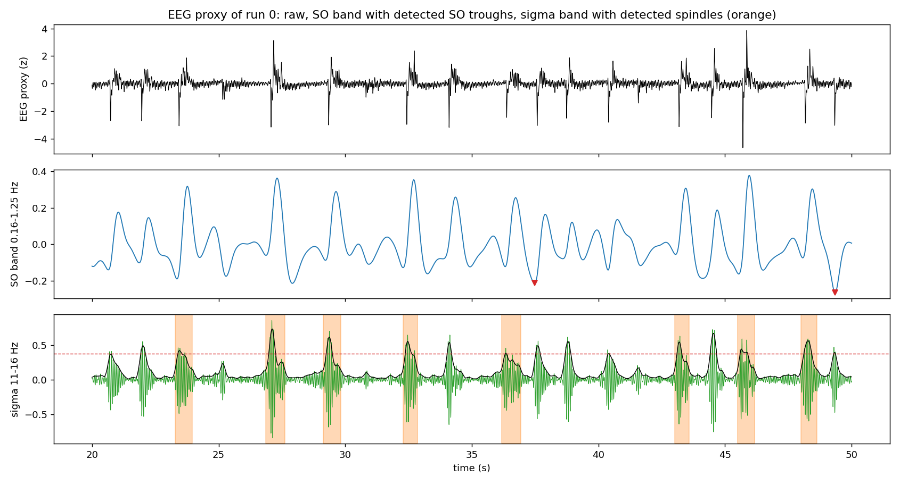

Raw proxy, SO band with detected troughs, sigma band with detected spindles (run 0, 30 s).

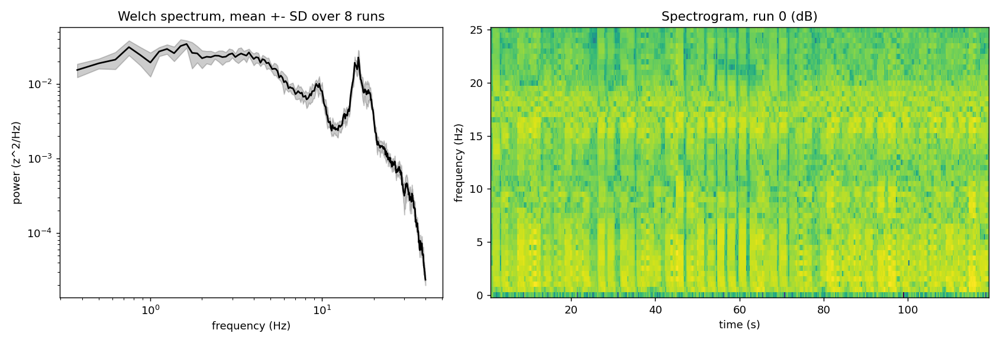

Spectrum over 8 runs (mean ± SD) and spectrogram of run 0.

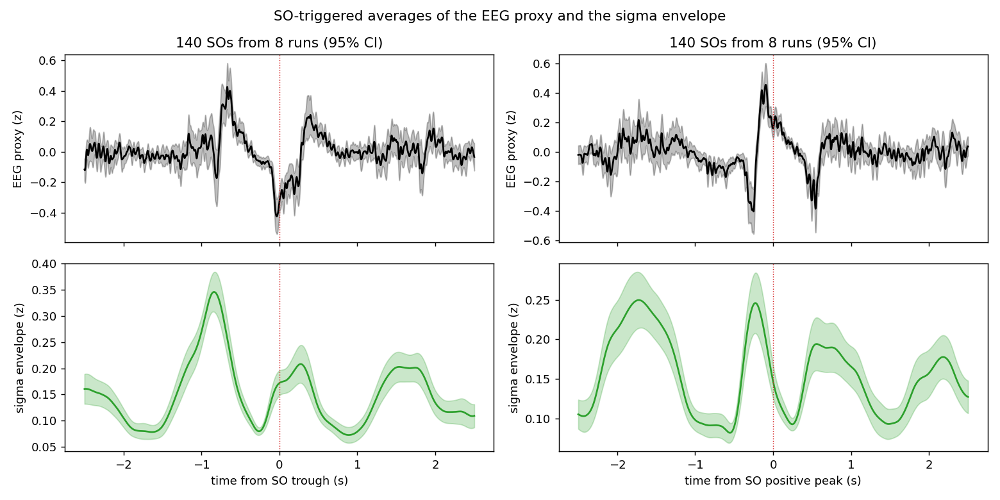

SO-triggered averages of the EEG proxy and the sigma envelope, locked to the trough and to the positive peak.

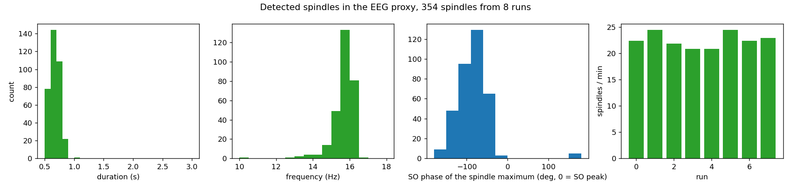

Spindle duration, frequency, SO phase of the maximum, and density per run.

### 3.5 Graphs in the format of the literature (added 19 November, after the discussion with Eduard Kelemen)

Requested: graphs like those in Moelle et al. 2002 (J Neurosci 22:10941, human scalp EEG, 13 subjects) and in the
N3 slides of the sleep-scoring course (30 s epochs, 1 s grid). `neuron/eeg_literature.py` repeats the paper's
procedure on the EEG proxy of section 3.4: slow-oscillation signal 0.16-4 Hz, spindle 12-15 Hz, beta 15-25 Hz,
alpha 8-12 Hz, theta 4-8 Hz, rms in a 0.1 s window; half-waves between two zero crossings 0.125-1 s apart; averages
over ±1 s around the half-wave peak, around the spindle centre, and the cross-correlation within ±2 s. Amplitudes
are z-units, so only shapes, timing and unit-free ratios are compared. Two deviations from the paper, both because
the proxy has no microvolts and the model bursts are short: (1) half-waves are the larger half (above the median
peak) of each polarity per run, where the paper used 80 µV raised per subject until more than 50 were found;
(2) spindles are 0.4-1.3 s events of the 12-15 Hz rms with the edges at its mean and the peak above mean + 1.5 SD
(with a single threshold only 2 per run were found).

**The result depends on one choice, the sign of the deep layers.** The proxy of section 3.4 sums L2/3, L4, L5 and
L6 excitatory cells with L5 and L6 sign-flipped. In this version the negative half-waves are not the DOWN state:
they are the sharp negative transient of the L5/L6 volley at each UP onset, so the spindle rms is high at both
polarities. I then tried the one alternative that scalp EEG argues for, superficial layers only (L2/3 and L4
excitatory, no flip), since scalp EEG is dominated by superficial dipoles. That is two variants tried, the second
chosen after seeing the first, so it is a modelling assumption, not a fit; both are shown.

| Measure | Moelle et al. 2002 (Cz) | Model, all four E layers (L5, L6 flipped) | Model, superficial E only (L2/3 + L4) |
|---|---|---|---|
| Half-waves per run | 114-122 per subject (larger ones, SWS) | 56 negative, 57 positive | 12 negative, 30 positive |
| Spindle rms, positive / negative half-wave peak | 3.32 / 2.30 µV, ratio 1.44 | 0.181 / 0.237 z, ratio 0.77 ± 0.02 | 0.489 / 0.210 z, ratio 2.43 ± 0.19 |
| Spindle rms change against the first 0.2 s | -22% (negative), +23% (positive) | +472% / +519% | -8 ± 9% / +1197% |
| Rebound of spindle rms after the negative half-wave | peak 400-500 ms after the trough, higher than at the positive peak | peak at +0.20 s, lower (0.127 vs 0.181) | peak at +0.20 s, lower (0.374 vs 0.489) |
| Beta rms, positive vs negative | increase at the positive half-wave, rebound at Cz | ratio 0.61 | ratio 14.8 |
| Alpha, theta rms | no similar change | ratios 0.80, 0.71 | ratios 4.3, 4.8 (changes as large as in spindle and beta) |
| Cross-correlation SO vs spindle rms | positive peak at -0.1 s, strongest (negative) peak at +0.4 s, moderate coefficients | positive peak -0.25 s (r = 0.41) | positive peak -0.10 s (r = 0.81); negative peaks at about ±0.7-0.8 s (r = -0.26) |
| Spindle-triggered SO signal | negative shift just before the spindle, positive with it, negative after | no pre-spindle negativity | positive peak +0.07 s after the centre; the dip before is only the flat baseline |
| Peak of the 0.16-4 Hz spectrum | 0.7-0.8 Hz | 1.17 ± 0.16 Hz | 0.57 ± 0.07 Hz |

What agrees, and what does not (superficial variant, which is closer):

- Spindle activity is grouped by the slow oscillation: much higher at positive half-waves, no increase at negative
  ones (-8% against -22%), and the cross-correlation peaks at -0.10 s, the lag Moelle et al. found (spindle rms
  peaks before the SO positive peak). The spindle-triggered average shows the spindle centred 0.07 s before the
  SO peak.
- The spindle-to-SO relation is far too strong and clean: the positive-peak ratio is 2.4 against 1.4, the
  correlation 0.81 against "moderate", and the +1197% rise against +23%. The model's spindle activity exists only
  at the UP states; the human data have spindle power at all phases. This is the same fact as the SO-spindle
  coupling R = 0.84-0.99 of sections 3.1 and 3.4.
- Alpha and theta rms change as much as spindle and beta rms (ratios 4-5), where Moelle et al. found no change.
  So the model's UP onset raises power in all bands: the modulation seen in the model is that of broadband
  UP-state activity, not specific to the spindle band. This is the main difference to the paper.
- The rebound after the negative half-wave (a spindle peak 400-500 ms after the trough, higher than at the positive
  peak) is not reproduced: the model peaks at +0.20 s and lower than at the positive peak. In the model the
  negative half-wave lies in the quiet baseline just before an UP onset, so the "rebound" at +0.2 s is the next UP
  state, and the structure of a rate-based proxy explains it without a thalamic rebound.
- No pre-spindle negative shift: a proxy built from spikes cannot go below the DOWN-state baseline, so the hyperpolarising
  negative half-wave of the scalp EEG (and with it the suppression of spindles, the rebound and the negative DC shift
  before spindles) is outside what this proxy can show. This limits all of the comparisons above that involve negative
  half-waves. A membrane-potential or synaptic-current proxy would be needed.
- The 0.16-4 Hz spectrum peaks at 0.57 Hz (superficial) or 1.17 Hz (all layers), around the human 0.7-0.8 Hz; the
  paper's small peak at about 0.25 Hz is not present.
- The epoch figure (the layout of the N3 slides) shows isolated large pulses with flat stretches between them, at
  about 0.7 per second. The N3 epochs on the slides show continuous, irregular, symmetric slow waves in all
  derivations. The AASM N3 amplitude criterion (75 µV) cannot be tested without a calibration of the proxy.

Figures (superficial variant, the closer one):

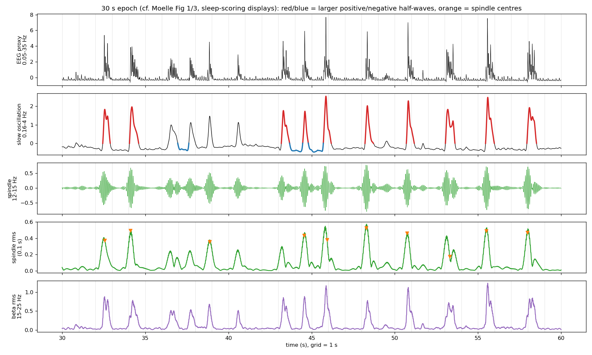

30 s epoch: EEG proxy, SO signal with the larger half-waves, 12-15 Hz band, spindle rms with detected centres, beta rms.

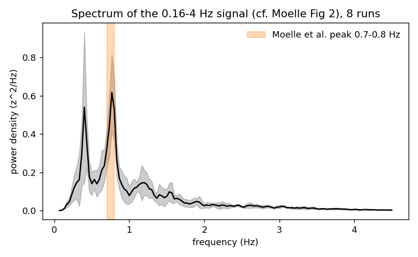

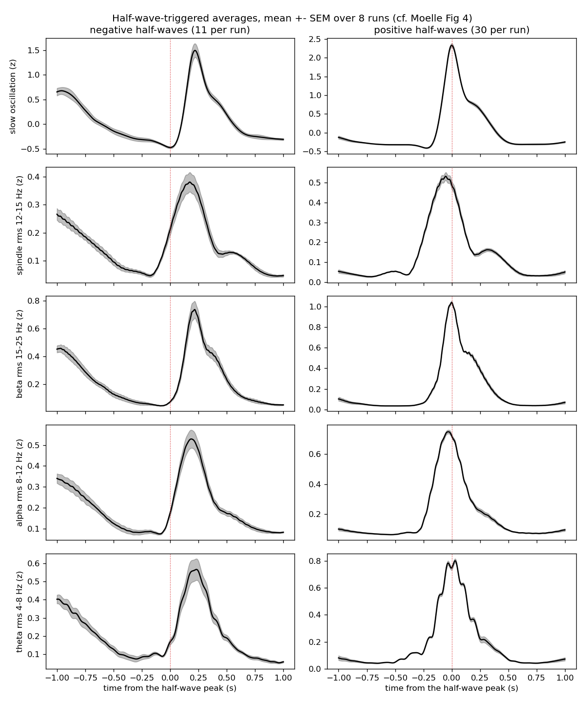

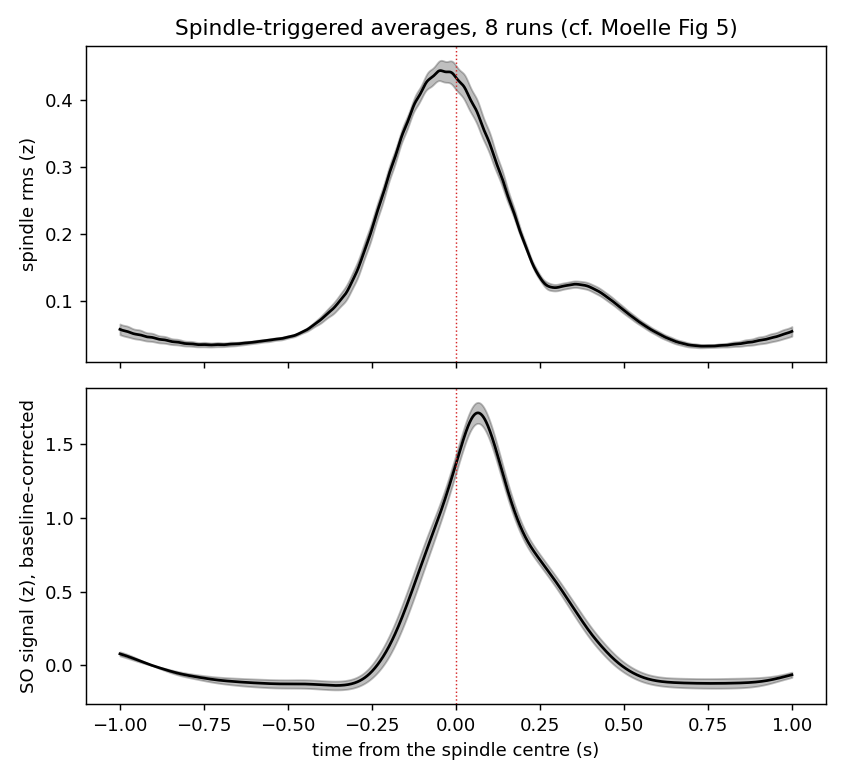

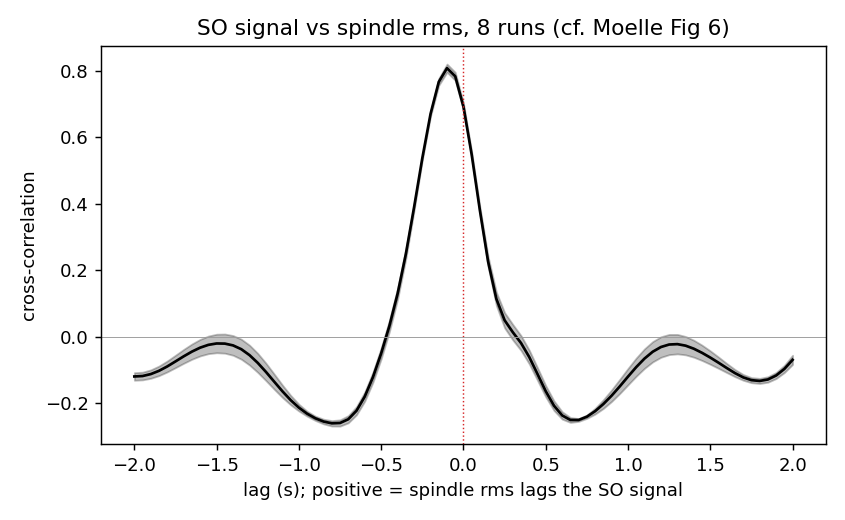

All four layers (L5, L6 sign-flipped), for comparison:

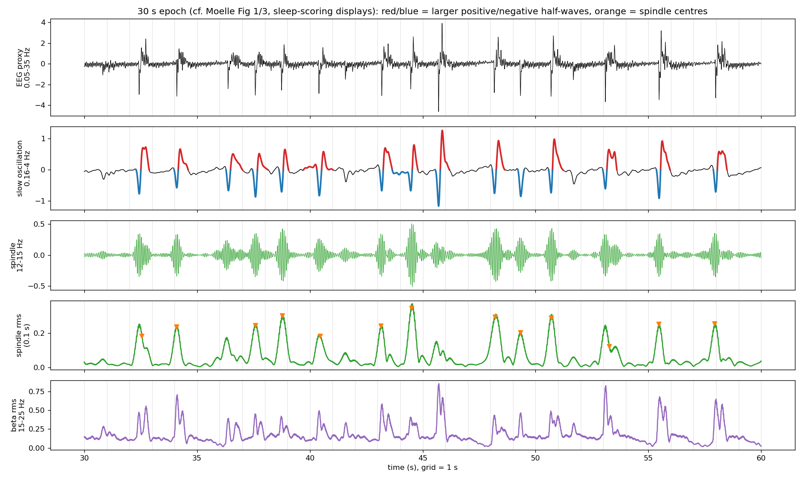

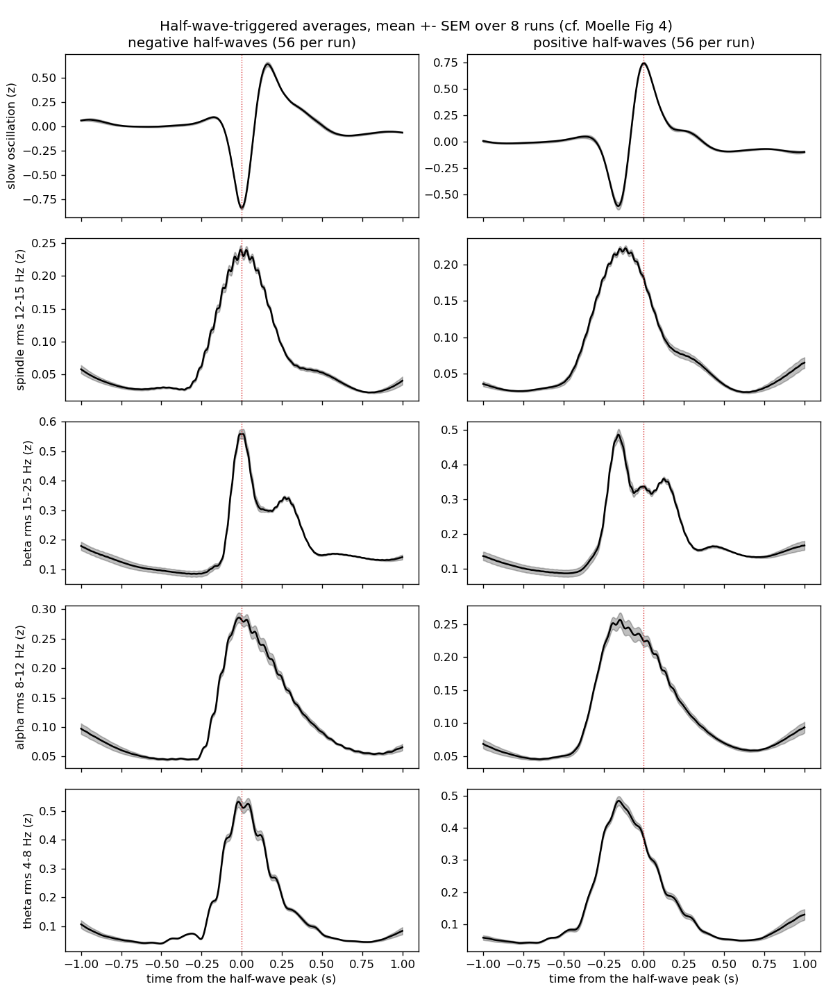

Other files: `figures/b120_lit_{spectrum,spindle_avg,xcorr}.png`, tables `res/2026-11-16/b120_lit_table.txt` and
`b120_litsup_table.txt` (local).

## 4. Comparison with the literature

The eight papers in `~/Downloads` were read for the numbers below (page-level values from the full
texts). Human numbers come from intracranial and scalp recordings, and depend on the detector, so
they are ranges, not targets.

| Reference | What it is |
|---|---|
| Andrillon et al. 2011, J Neurosci 31:17821 (`zns17821.pdf`) | intracranial EEG and single units in 13 patients; spindle density, frequency, SO coupling, unit firing |
| Gonzalez et al. 2022, J Neurosci 42:4517 (`zns4517.pdf`) | 20 patients, 357 cortical sEEG channels; spindle density, duration, frequency (Table 2) |
| Staresina et al. 2015, Nat Neurosci 18:1679 (`emss-64810.pdf`) | SO-spindle-ripple nesting in human intracranial recordings |
| Malerba et al. 2022, Sleep (`zsac132.pdf`) | scalp EEG, 34 subjects; spindle types and coupling to SOs |
| Coppieters 't Wallant et al. 2016, Neural Plast (`NP2016-6783812.pdf`) | review of spindle definition and detection |
| Chauvette et al. 2010, Cereb Cortex 20:2660 | origin of active states, cat, multisite recordings |
| Miyawaki and Diba 2016, Curr Biol 26:893 (`nihms-767564.pdf`) | hippocampal firing across NREM (rodent); defines DOWN states |
| Halonen et al. 2021, Front Behav Neurosci 15:712774 (`fnbeh-15-712774.pdf`) | SO-spindle coupling and memory; background only |

| Feature | Model | Literature (source) | Verdict |
|---|---|---|---|
| SO frequency | 0.70 UP/s | about 0.75 Hz (Staresina); slow waves 0.5-4 Hz and "about 1 Hz" in NREM (Miyawaki and Diba) | inside the range |
| Spindle frequency | 13.8 Hz (volley trains) | cortex mean 12.28 Hz NREM (Gonzalez, Table 2); fast centroparietal 13-15 Hz, slow frontal 9-12 Hz (Andrillon); AASM 11-16 Hz, most commonly 12-14 Hz (Coppieters) | in the fast range, about 1.5 Hz above the cortical mean |
| Spindle duration | 0.51 s | cortex 0.70 s NREM, 0.68-0.72 s per region (Gonzalez, Table 2); minimum 0.5 s "seemingly without any firm objective physiological" basis, some authors use 0.3 s (Coppieters) | shorter |
| Spindle density | 25.8 per min | cortex 1.64 per min NREM (frontal 2.12, parietal 2.30; Gonzalez); scalp 1.9 per min, frontal 1.8, parietal 1.3 (Andrillon) | 11-16 times too many |
| Intraspindle frequency | not measured | decreases within a spindle, about -0.8 Hz/s (Andrillon) and more in frontal than parietal spindles (Gonzalez) | not tested |
| Spindles and the SO up-state | start at -47°, R = 0.99, all spindles | spindles occur more often after the transition to the up-state; preferred SO phase of spindle power 328° (about -32°) at Cz and 160° with the up-state at 180° in the hippocampus, i.e. about -20° (Staresina); only about 10% of S2 spindles closely follow an SO (Malerba) | right phase, far too many coupled |
| Spindle activity of units | not measured | firing rates "are not consistently modulated" during spindles, although 19.5% of units are phase-locked (Andrillon) | not tested |
| Where an UP state starts | L5/L6 first (by construction), then L2/3 I, RE, L2/3 E, TC, L4 | deep cells fire first on average by a few ms (-1.1 ± 7.4 ms for deep and +0.5 ± 4.4 ms for middle cells in the sigmoid-fit method, superficial cells positive and close to zero), but activity "may start in any neuron" (Chauvette) | the same direction but a much larger spread in the data; the model result is circular (section 5) |
| Layer 5 in the DOWN state | L5 E 2.8 Hz, L5 I 37 Hz, tonic 17.5 Hz rhythm | L5 cells firing continuously in the silent state was seen only in slices; "never observed in vivo" in anesthetized or naturally sleeping cats (Chauvette) | disagrees |
| DOWN state | population never silent in L5 | defined as more than 50 ms without unit spikes (Miyawaki and Diba, citing refs 8 and 9) | the L5 population never satisfies it |
| Mean firing rate | per group 0.18-44 Hz (table 3.3) | recorded human units 3.1 ± 0.3 Hz on average; phase-locked units 5.9 ± 1.2 Hz (Andrillon); no rates per cell type in the eight papers | not comparable per group |

What the comparison says:

1. **The slow oscillation is right and the spindle phase is right.** The UP rate is in the human range,
   and the spindle start at -47° of the SO is close to the preferred phases found in humans (-32° and
   -20°).
2. **The spindle count is too high.** The density is 11-16 times the human values (1.6-2.3 per min), and
   only part of that is the definition. The model counts RE volley trains of at least 6 volleys at
   intervals up to 150 ms, which is a looser criterion than amplitude detection in a band-passed LFP; I
   have not run the same detector on the model's LFP proxy. A threshold of 6 cycles also puts a floor
   under the duration (6 cycles at 13.8 Hz is 0.43 s), so the 0.51 s is mostly the criterion.
3. **The coupling to the SO is far too deterministic.** In humans spindles are only partly coupled to
   SOs (about 10% of S2 spindles closely follow an SO in the scalp data, Malerba), and the model has
   one fixed phase for all of them (R = 0.99). This suggests that spindles in the model are triggered by
   the UP-state volley and do not appear on their own, as they do in recordings. This is my
   interpretation.
4. **Layer 5 behaves unlike cortex in vivo.** Its tonic firing between UP states is the pattern that
   Chauvette et al. found only in slices. The L5 I mean of 44 Hz is high against the human unit mean of
   3.1 Hz, but that mean mixes cell types, so I treat it as a flag, not a result.

## 5. Caveats

- The onset latency is circular for L5 and L6, because the UP onset is detected on them. The
  conclusion "deep layers first" cannot come from this analysis; an onset detected from a neutral
  signal (for example the sum of all cortical spikes, or the L2/3 E rate) is needed.
- LFP proxies, not fields: a spike-based PSP kernel with a sign convention, no geometry, no real
  extracellular potential. The 100 ms kernel hides the spindle band, so the sigma shares of the
  proxy are lower than in a real LFP.
- Runs are 120 s (about 85 UP states each) and 8 seeds; the SD between runs is shown, not a
  bootstrap interval. The latency of L2/3 E varies a lot between runs (66 ± 44 ms).
- The literature numbers were read in the full texts of the eight papers (in the Downloads folder). Malerba et al. 2022 was only partly readable (the PDF is mostly images; the abstract was
  read, the results were not). Spindle recurrence every 4 s, which I mentioned before, is not in any of
  the eight papers, so it is dropped. Rates per cell type are not in them either.
- The human values are from patients with epilepsy (intracranial) and scalp EEG; Chauvette is in cats;
  Miyawaki and Diba is in rodents. The comparison is order-of-magnitude, not a fit.

## 6. Next steps

1. Redo the onset latencies with an onset detected from a signal that does not use L5 or L6.
2. Done in section 3.4 (amplitude detector on the EEG proxy). Left to do: a head model or at least a
   per-layer dipole weighting for the proxy, and, above all, a current-based or membrane-potential source
   (see `reports/REPORT-2026-11-20-EEG.md`).
3. Find NREM firing rates per cell type (pyramidal, interneuron; UP and DOWN) in papers with unit
   recordings, and compare with the table in section 3.3. Look at the L5 tonic rhythm and the L5
   DOWN-state activity in the model (L5 recurrence and IB cells), since Chauvette et al. found that
   pattern only in slices.
3b. Measure spindle coupling per spindle (fraction of spindles that follow an UP within a window, as in
   the scalp analysis) to compare with the 10% value.
4. Repeat after any change in the thalamic excitability (K_Na, IC-to-TC weight), since the same
   network is used for all stimulation experiments.

## 7. Where things are

| What | Where |
|---|---|
| Analysis and tests | `neuron/lfp_baseline.py`, `neuron/test_lfp_baseline.py`, `neuron/eeg_proxy.py`, `neuron/test_eeg_proxy.py`, `neuron/eeg_literature.py`, `neuron/test_eeg_literature.py` |
| EEG-proxy table | `res/2026-11-16/b120_eeg_table.txt` (local) |
| Recipe (B120) | `MN5_NEURON.md` |
| Table | `res/2026-11-16/b120_table.txt` (local) |
| Figures | `figures/b120_traces.png`, `figures/b120_spectra.png`, `figures/b120_rates.png` |
| Earlier reports | `reports/REPORT-2026-11-10.md`, `reports/REPORT-2026-10-23-stimulation-comparison.md` |
