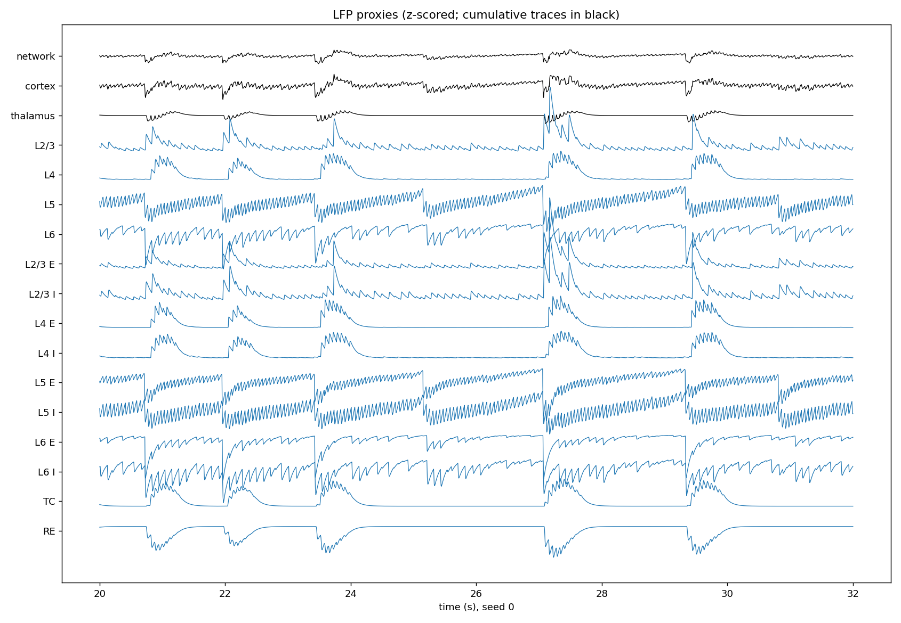
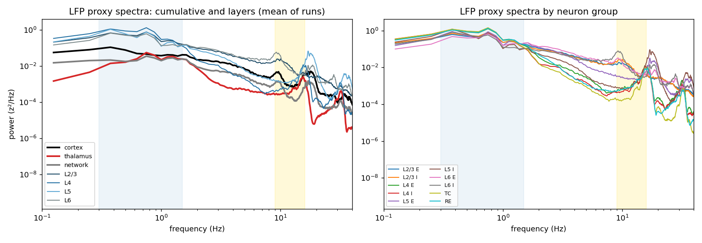
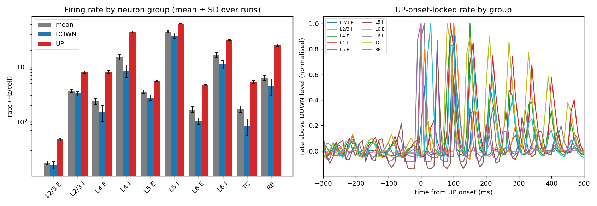

# Baseline activity and field potentials of the model without stimulation, and comparison with the literature (16 November 2026)

Corticothalamic sleep model (NEURON, MPI, MareNostrum 5): 8 runs of 120 s on 5,031 cells
(scale 1.65, seeds 0-7, 100 ranks), with no auditory input. The runs are bit-identical to the
first 120 s of the sham arms of F2 (`reports/REPORT-2026-11-10.md`), so this is the undisturbed
network that every stimulation experiment is compared with. The recipe is in `MN5_NEURON.md`
("B120"). File paths are relative to the repository root; raw outputs (`res/`) are not in git.

## 1. Summary

- **Slow oscillation:** 0.70 ± 0.07 UP onsets per second, irregular (CV 0.44). This is inside the
  usual range for the slow oscillation (about 0.75 Hz in human recordings, 0.5-1.5 Hz as a band).
- **Spindles:** the model produces them at 13.8 Hz, which fits fast human spindles, and they start
  at a fixed SO phase just before the UP-state peak (-47°, vector strength 0.99). But there are 26
  per minute against 2-5 per minute in human recordings, they are short (0.51 s, the lower edge of
  the 0.5-2 s range) and the phase lock is far tighter than a statistical preference. See section 4
  for how much of this is the definition.
- **Field potentials:** the cumulative cortical proxy has 32% of its 0.3-40 Hz power in the SO band
  (0.3-1.5 Hz) and 30% in delta (1.5-4 Hz); the thalamic proxy has 56% in the SO band. L4, TC and RE
  are the most SO-dominated traces (82-89%).
- **UP-state onset:** the UP onset is detected from L5 and L6, so those two layers lead by
  construction. After them, L2/3 interneurons (10 ms), RE (22 ms), L2/3 pyramidal cells (66 ms), TC
  (80 ms) and L4 (85-90 ms) follow.
- **Two things that do not look like sleep data:** L5 fires all the time in the DOWN state (L5 E 2.8
  Hz, L5 I 37 Hz) with a tonic 17.5 Hz rhythm, so the DOWN state is not silent in L5; and the
  interneuron rates are high (L5 I 44 Hz mean, L4 I 15 Hz, L6 I 17 Hz).
- **No reference rates in section 4:** I did not find verified NREM firing rates per cell type, so the
  rates are not compared numerically.

## 2. Methods

Analysis: `neuron/lfp_baseline.py` (3 unit tests in `neuron/test_lfp_baseline.py`). First 2 s of
each run skipped; values are mean ± SD over the 8 runs.

- **LFP proxy** of a trace = its spikes convolved with a PSP kernel (2 ms rise, 100 ms decay;
  `ctx_analyze._synaptic_lfp`), z-scored, with the deep layers (L5, L6) and RE sign-flipped as in the
  earlier composite LFP. The thalamic traces are proxies, not measured fields, and the sign
  convention is a modelling choice.
- **Traces:** the 10 neuron groups (L2/3, L4, L5, L6 excitatory and inhibitory, TC, RE); the 4
  layers (excitatory and inhibitory spikes pooled); and the cumulative traces, the cortical
  composite (mean of the 4 layers), the thalamic composite (mean of TC and RE) and the network
  (mean of the two).
- **Spectra:** Welch, 8 s segments (0.125 Hz resolution), as fractions of the 0.3-40 Hz power. The
  100 ms kernel attenuates 12 Hz about 8-fold, so the sigma-band share of the LFP proxy is
  underestimated; the sigma peak and share are therefore also taken from the population rate in 5 ms
  bins.
- **UP onsets** from the L5 and L6 excitatory rate (`stage2_report.up_onsets`). UP window = 0-300 ms
  after the onset, DOWN window = -400 to -100 ms.
- **Spindles** = RE volley trains of at least 6 volleys with at most 150 ms between volleys
  (`volley_stats.py`). SO phase at the spindle start from the zero-phase SO band (0.3-1.5 Hz) of the
  cortical E rate, 0° = UP maximum.

## 3. Results

Figures: `figures/b120_traces.png` (12 s of all traces), `figures/b120_spectra.png`,
`figures/b120_rates.png`. Full table: `res/2026-11-16/b120_table.txt`.

### 3.1 Slow oscillation and spindles

| Measure | Value (8 runs) |
|---|---|
| UP onsets per s | 0.70 ± 0.07 |
| CV of UP intervals | 0.44 ± 0.06 |
| Spindles per min | 25.8 ± 2.9 |
| Spindle duration (median) | 0.51 ± 0.04 s |
| Cycles per spindle | 8.0 ± 0.9 |
| Frequency inside a spindle | 13.8 ± 0.1 Hz |
| SO phase at spindle start | -47° (0° = UP maximum), vector strength 0.99, n = 406 |

### 3.2 Cumulative and per-layer field potentials

Fraction of the 0.3-40 Hz power:

| Trace | SO 0.3-1.5 | delta 1.5-4 | theta 4-8 | sigma 9-16 | beta 16-40 |
|---|---|---|---|---|---|
| **cortex (cumulative)** | 0.32 ± 0.02 | 0.30 ± 0.02 | 0.12 | 0.08 | 0.12 ± 0.02 |
| **thalamus (cumulative)** | 0.56 ± 0.03 | 0.20 ± 0.03 | 0.03 | 0.09 | 0.05 |
| **network (cumulative)** | 0.39 ± 0.03 | 0.30 ± 0.02 | 0.11 | 0.05 | 0.08 ± 0.01 |
| L2/3 | 0.51 | 0.22 | 0.10 | 0.09 | 0.04 |
| L4 | 0.86 | 0.07 | 0.01 | 0.02 | 0.02 |
| L5 | 0.54 ± 0.08 | 0.17 | 0.02 | 0.02 | 0.21 ± 0.07 |
| L6 | 0.40 | 0.24 | 0.12 | 0.11 | 0.06 |

Each layer and neuron group is in `res/2026-11-16/b120_table.txt`. In short:

- The SO band dominates TC (0.89), L4 I (0.87), L4 E (0.82) and RE (0.83), which follow the UP
  states with a burst and then go quiet.
- L5 has a large share at 16-40 Hz (0.21; L5 I 0.28), which comes from a tonic rhythm with a peak at
  17.5 Hz that runs all the time between UP states (visible in the traces).
- L2/3 and L6 have the most theta and sigma power (0.10-0.12 and 0.09-0.14).
- The thalamic spectrum has the sharpest SO band of all traces, and the cumulative cortical spectrum
  is the flattest, since layers with different timing partly cancel.
- Population-rate spectra (5 ms bins): the highest peak between 5 and 30 Hz is at about 16 Hz in L4,
  TC and RE (the spindle volleys), at 17.5 Hz in L5 (the tonic rhythm) and at 9-10 Hz in L2/3, L6
  I and most L6 E runs. The sigma band (9-16 Hz) holds 22-27% of the rate power in L2/3, L4, L6, TC
  and RE and only 5% in L5.

### 3.3 Firing rates (Hz per cell)

| Group | Mean | UP (0-300 ms) | DOWN (-400 to -100 ms) | UP/DOWN | Onset latency |
|---|---|---|---|---|---|
| L2/3 E | 0.18 ± 0.01 | 0.47 | 0.16 | 2.9 | 66 ± 44 ms |
| L2/3 I | 3.67 ± 0.21 | 8.04 | 3.28 | 2.4 | 10 ms |
| L4 E | 2.39 ± 0.29 | 8.19 | 1.49 | 5.5 | 85 ± 5 ms |
| L4 I | 15.1 ± 1.6 | 43.6 | 8.5 | 5.1 | 90 ms |
| L5 E | 3.53 ± 0.27 | 5.57 | 2.76 | 2.0 | -10 ms |
| L5 I | 44.4 ± 2.9 | 61.6 | 37.3 | 1.7 | 0 ms |
| L6 E | 1.68 ± 0.20 | 4.68 | 1.02 | 4.6 | 0 ms |
| L6 I | 16.6 ± 1.7 | 30.9 | 11.2 | 2.8 | 0 ms |
| TC | 1.71 ± 0.23 | 5.32 | 0.84 | 6.3 | 80 ms |
| RE | 6.33 ± 0.65 | 24.8 | 4.5 | 5.5 | 22 ± 4 ms |

The latency is the time at which the rate crosses half of the rise from the DOWN level to the peak,
in 10 ms bins. The L5 and L6 values are 0 by construction, because the UP onset is defined on them.

## 4. Comparison with the literature

Only values I found in the sources below are quoted; where a source did not give the number, that is
said. Human values come from scalp and intracranial recordings and the numbers depend on the
detection method, so they are ranges, not targets.

| Feature | Model | Literature | Verdict |
|---|---|---|---|
| Slow oscillation frequency | 0.70 UP/s | about 0.75 Hz ([Staresina et al. 2015](https://pmc.ncbi.nlm.nih.gov/articles/PMC4625581)); about 1 Hz in non-REM ([Miyawaki and Diba 2016](https://pmc.ncbi.nlm.nih.gov/articles/PMC4821660)); detection bands 0.5-1.5 or 0.5-4 Hz | inside the range |
| Spindle frequency | 13.8 Hz (volley trains); LFP/rate peaks at 9-17 Hz | 10-16 Hz; fast spindles 12-14 Hz; intracranial mean about 12.3 Hz ([PMC9172080](https://pmc.ncbi.nlm.nih.gov/articles/PMC9172080)) | inside the fast-spindle range |
| Spindle duration | 0.51 s (8 cycles) | 0.5-2 s | at the lower edge |
| Spindle density | 25.8 per min | scalp about 4.4-4.6 per min ([PMC8439423](https://pmc.ncbi.nlm.nih.gov/articles/PMC8439423)); intracranial about 1.6-2.3 per min ([PMC9172080](https://pmc.ncbi.nlm.nih.gov/articles/PMC9172080)); hippocampal about 5.4 per min as reported for Staresina et al. 2015 | 5-15 times too many |
| Spindles and the SO up-state | start at -47°, R = 0.99 | spindle amplitude modulated by the SO up-state ([Staresina et al. 2015](https://pmc.ncbi.nlm.nih.gov/articles/PMC4625581)); fast spindles occur with slow-wave up-states, slow ones about 200 ms later (one of the sources found) | right preference, far too deterministic |
| Spindle grouping | not measured | spindles recur about every 4 s (one source found) | not tested |
| Where an UP state starts | L5/L6 first by construction; then L2/3 I, RE, L2/3 E, TC, L4 | in cats, active states usually start deep, then involve superficial cells, and reach the middle layers later ([Chauvette et al. 2010](https://volgushev.lab.uconn.edu/wp-content/uploads/sites/2605/2019/02/Chauvette_CerCortex2010v20p2660.pdf)) | same order, but circular (see caveats) |
| DOWN state | L5 E 2.8 Hz, L5 I 37 Hz in the DOWN window | DOWN states are defined in recordings as more than 50 ms without population spikes (Miyawaki and Diba 2016) | L5 never goes quiet |
| Firing rates per cell type | table in 3.3 | not found in a verified source | not compared |

What the comparison says:

1. **The slow oscillation and the spindle frequency are right.** The UP rate is in the human range
   and the 13.8 Hz of the spindles matches fast spindles.
2. **The spindle count is too high, partly by definition.** A volley train of at least 6 volleys
   within 150 ms intervals in RE is a looser criterion than amplitude detection in a band-passed LFP,
   which requires a minimum amplitude and a duration; it counts events that would fall below a
   detection threshold. The 0.51 s duration sits at the floor that the criterion allows (6 cycles at
   13.8 Hz is 0.43 s), so this number mostly reflects the criterion. A fair density comparison needs
   the same detector on the model's cortical LFP proxy, which I have not done.
3. **The phase lock (R = 0.99) is almost certainly too strong.** The literature reports spindles
   preferentially in the up-state, not at one phase; the exact strength in human data is not in the
   sources I opened. That nearly every spindle starts at the same phase suggests that spindle onset in
   the model is set by the UP-state volley, so spindles do not appear on their own in the DOWN state
   as they do in recordings. This is my interpretation.
4. **L5 behaves differently from the other layers.** It fires at 2.8 Hz (E) and 37 Hz (I) between UP
   states, with a 17.5 Hz tonic rhythm and the beta-range share of its LFP (0.21). The L5 I mean of
   44 Hz and the L4 I and L6 I means (15-17 Hz) are high for interneurons, but I did not find a
   verified reference, so this is a flag, not a finding.

## 5. Caveats

- The onset latency is circular for L5 and L6, because the UP onset is detected on them. The
  conclusion "deep layers first" cannot come from this analysis; an onset detected from a neutral
  signal (for example the sum of all cortical spikes, or the L2/3 E rate) is needed.
- LFP proxies, not fields: a spike-based PSP kernel with a sign convention, no geometry, no real
  extracellular potential. The 100 ms kernel hides the spindle band, so the sigma shares of the
  proxy are lower than in a real LFP.
- Runs are 120 s (about 85 UP states each) and 8 seeds; the SD between runs is shown, not a
  bootstrap interval. The latency of L2/3 E varies a lot between runs (66 ± 44 ms).
- The literature numbers come from web searches of abstracts and tables, not full-text reading, and
  several values were reported by the search results rather than checked in the papers. Rates per cell
  type were not found.
- One source on spindle recurrence and the slow-spindle delay was not identified in the results.

## 6. Next steps

1. Redo the onset latencies with an onset detected from a signal that does not use L5 or L6.
2. Detect spindles on the cortical LFP proxy with an amplitude criterion (sigma-band envelope), to
   compare density and duration with the human numbers on equal terms, and measure the spread of the
   spindle phase on that detector.
3. Find verified NREM firing rates per cell type (pyramidal, interneuron; UP and DOWN) and compare
   with the table in section 3.3. The L5 rhythm and the L5 DOWN-state activity should be looked at
   in the model (L5 recurrence and IB cells).
4. Repeat after any change in the thalamic excitability (K_Na, IC-to-TC weight), since the same
   network is used for all stimulation experiments.

## 7. Where things are

| What | Where |
|---|---|
| Analysis and tests | `neuron/lfp_baseline.py`, `neuron/test_lfp_baseline.py` |
| Recipe (B120) | `MN5_NEURON.md` |
| Table | `res/2026-11-16/b120_table.txt` (local) |
| Figures | `figures/b120_traces.png`, `figures/b120_spectra.png`, `figures/b120_rates.png` |
| Earlier reports | `reports/REPORT-2026-11-10.md`, `reports/REPORT-2026-10-23-stimulation-comparison.md` |
