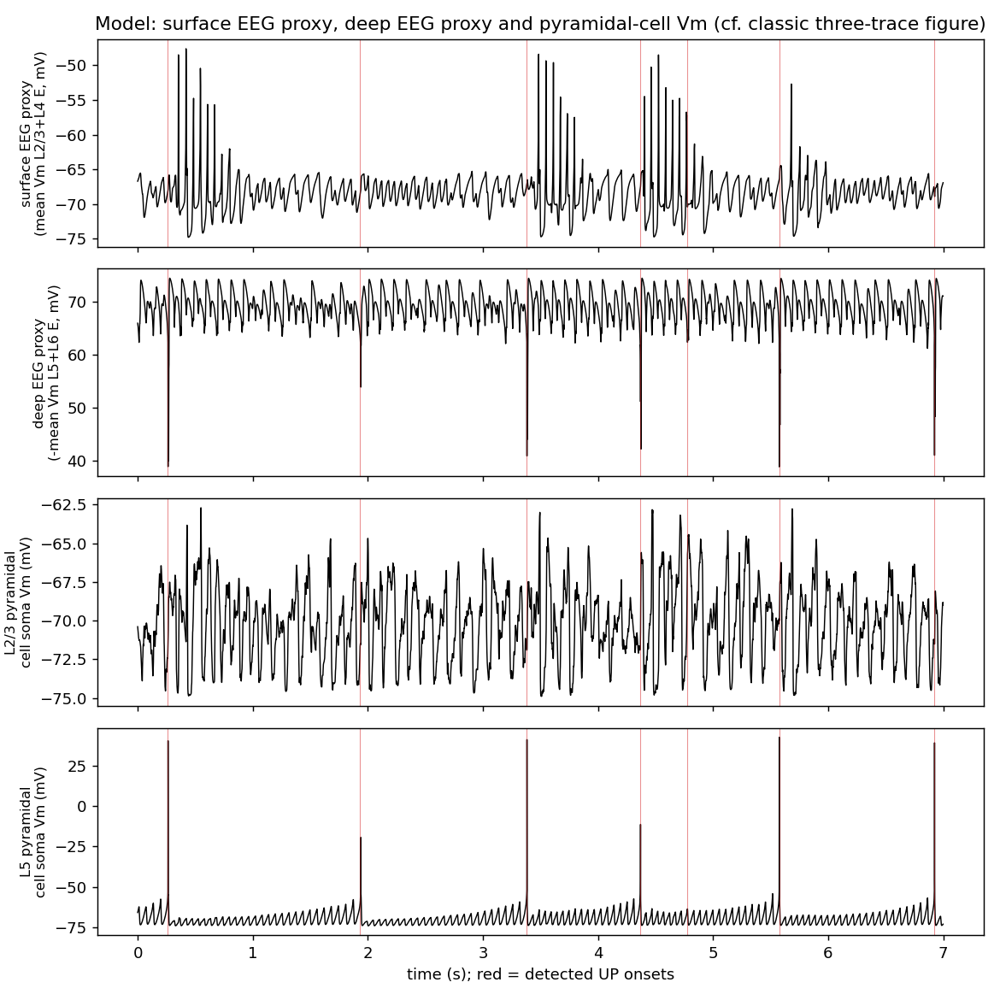
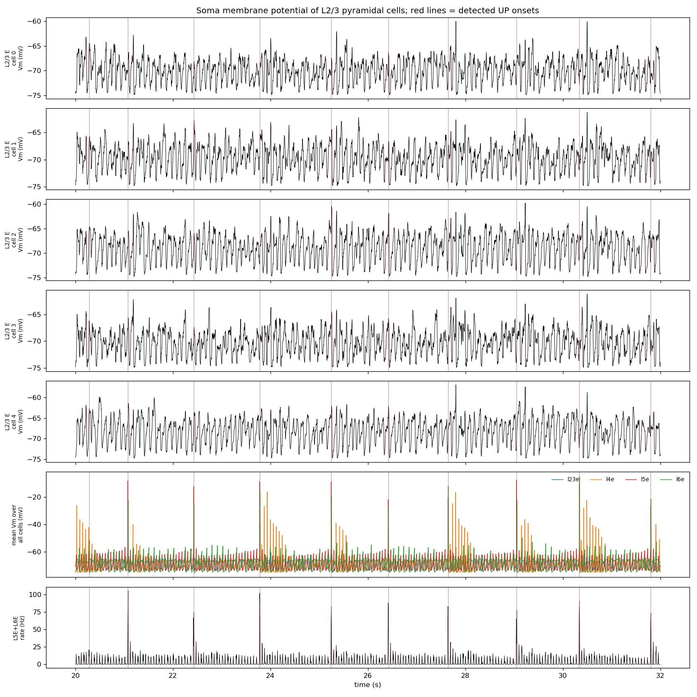
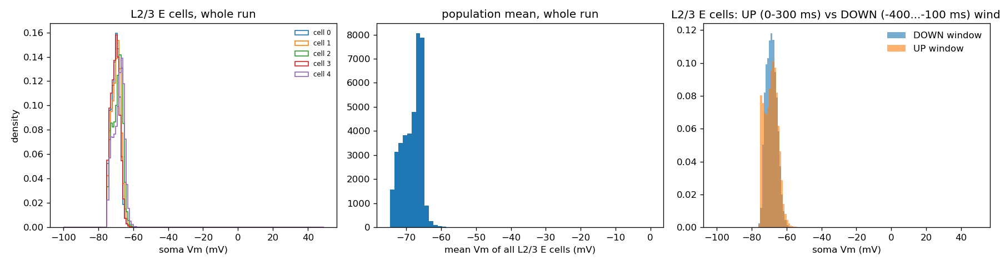
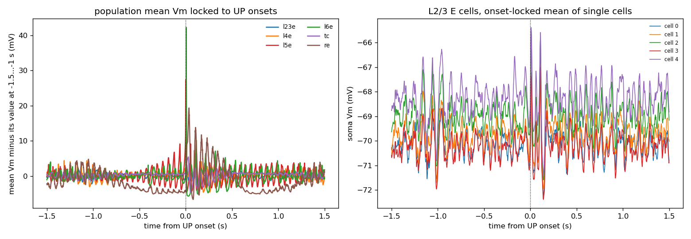
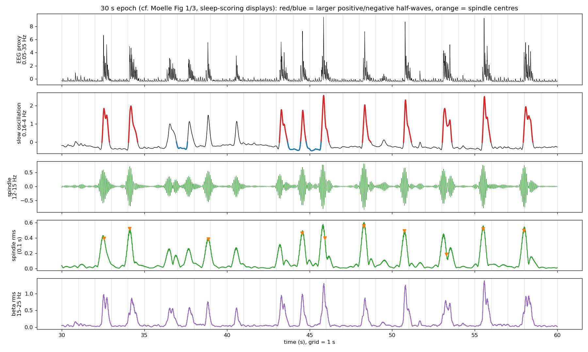
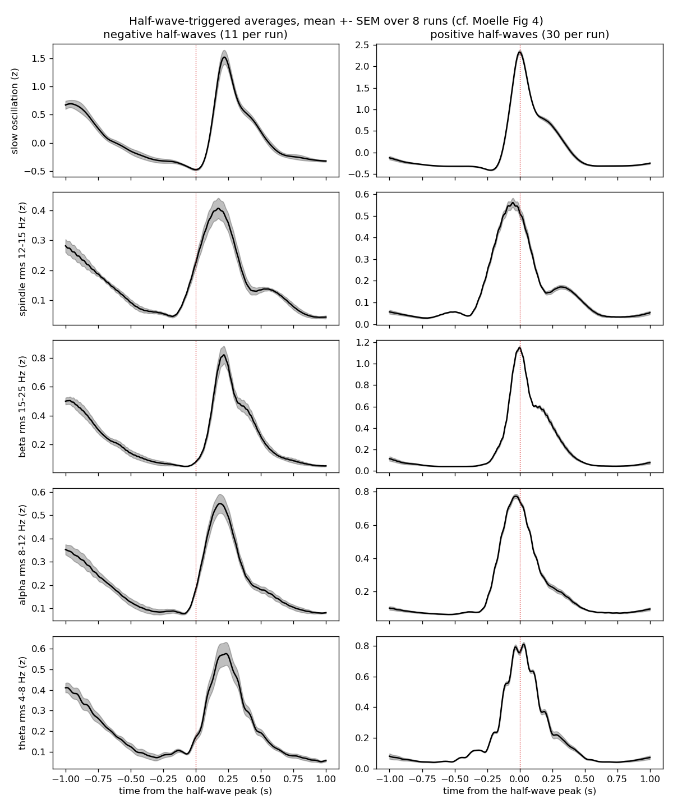

# EEG of the model: current state, surface EEG without skull, and the membrane potential (20 November 2026)

Follows the discussion with Eduard Kelemen: biological EEG shows a periodicity tied to the UP and DOWN states of the
neurons that generate it, and our graphs did not. Requests handled here: (1) remove the artificial noise, (2) make
the brain-surface EEG with no cranial distortion, (3) show the membrane potential of an L2/3 pyramidal cell to
check the UP and DOWN states, (4) write this report. Earlier work: `reports/REPORT-2026-11-16-baseline-LFP.md`
(sections 3.4 and 3.5, the scalp proxy and the Moelle et al. 2002 graphs).

## 1. Summary

- **Noise removed.** The 1/f background added on 19 November is deleted from the code, the report and the
  figures (it stays in the git history, commit `30a54a5`). All EEG graphs below are signal only.
- **Surface EEG without skull.** A version of the proxy with no skull/scalp low-pass and a wide band (0.05-200 Hz) is
  added (`eeg_literature.py --surface`). Result: practically identical to the scalp proxy (all numbers within a few
  percent), because the 40 Hz skull low-pass does not touch the bands analysed (SO, 4-25 Hz). The skull was never
  the reason the graphs differ from biology.
- **The reason is in the membrane potential.** For the first time the simulator records membrane potential
  (`--vm-record`). In a full-scale 40 s run, **the L2/3 pyramidal cells have no UP and DOWN states in their
  membrane potential**: it is one narrow distribution, -75 to -61 mV (1st to 99th percentile), with a 10-16 Hz
  ripple of 3-6 mV and a UP-minus-DOWN difference of 0.0 mV (L2/3 E). Biology shows a sustained depolarisation with
  firing: in cat cortex the somatic potential of layer 5 pyramidal cells is depolarised "by up to 15-20 mV" in the
  active state (Chauvette et al. 2010), and the classic three-trace figure shows 20 mV plateaus with bursts of spikes.
  So the model has the **timing** of the slow oscillation (0.7 UP per second) as a synchronous burst of the deep
  layers and the thalamic RE, but not the **membrane-potential state** in the cortical pyramidal cells. That is the
  periodicity that is missing in the EEG proxy, and noise or skull filters cannot create it.
- The thalamic RE cells do show a state change: mean Vm -81 mV before and -73 mV in the UP window (+8 mV).

## 2. What was done

1. `neuron/eeg_literature.py`: noise code removed; `--surface` (no skull filter, 0.05-200 Hz); `--vm POPS` (surface
   potential from the recorded membrane potential).
2. `neuron/ctx_thalamus_mpi.py`: new opt-in flags `--vm-record N` and `--vm-dt` (default off). The simulator
   records the soma potential of every cell, stores for each of the ten populations the mean over all its cells
   (`vm_mean_<pop>`, 1 kHz) and the traces of its first N cells (`vm_cells_<pop>`). It only reads `v`, so the
   dynamics are unchanged. With the flag off, runs are as before.
3. `neuron/vm_report.py`: the Vm figures and table.
4. The run: full scale (5031 cells, 40 s, HET_SEED 0, the B120 settings, `--cx-noise-rate 200`), made **locally**
   on 8 cores (NEURON 9.0.2, Python 3.13), 79 minutes. Not made on MN5. It is not compared spike for spike with
   B120 seed 0 (different number of ranks), but the totals agree: 1.058 million spikes in 40 s against 1.081
   million per 40 s in B120 seed 0, and 0.695 RE events per second against 0.70 UP per second.
   One run, one seed: no error bars below.

## 3. Results

### 3.1 Membrane potential (one 40 s run, 30 UP onsets)

| Population | mean Vm (mV) | UP window (0-300 ms) | DOWN window (-400...-100 ms) | UP - DOWN |
|---|---|---|---|---|
| L2/3 E | -68.3 | -68.3 | -68.2 | 0.0 |
| L4 E | -68.7 | -69.2 | -68.3 | -1.0 |
| L5 E | -69.6 | -70.0 | -69.1 | -0.9 |
| L6 E | -69.0 | -69.2 | -68.9 | -0.2 |
| L4 I / L5 I / L6 I | -66.3 / -62.7 / -66.1 | | | +3.2 / +1.7 / +1.6 |
| TC | -71.0 | -71.8 | -70.6 | -1.2 |
| RE | -78.2 | -73.2 | -81.2 | +8.0 |

Single L2/3 E cells (10 sampled): UP minus DOWN between -0.5 and +0.3 mV. Fraction of time above -55 mV (spiking
range): 0.1% (L2/3 E), 0.3% (L5 E), 0.8% (L4 E, L6 E). The Vm spectrum of single cells peaks at 9.8 Hz (L2/3 E), 16.1
Hz (L4 E), 17.1 Hz (L5 E) and 10.0 Hz (L6 E): the potential is dominated by the same 10-17 Hz rhythms seen in the
spike spectra, not by the 0.7 Hz slow oscillation.

Layout of the classic figure (surface EEG, deep EEG, pyramidal cell), 7 s, red lines = detected UP onsets. Surface EEG
proxy = mean Vm of L2/3 and L4 E cells (a depolarisation is surface-positive); deep EEG proxy = minus the mean Vm of
L5 and L6 E cells (a depolarisation is depth-negative, the polarity reversal described by Chauvette et al. 2010).
Units are mV of mean membrane potential, not microvolts. The deep proxy has the sharp negative deflection at each UP
onset, as in the classic deep trace, but it is a narrow spike (a few ms), not a 0.5 s slow wave with recovery. The
surface proxy has no slow positive wave: the mean Vm of L2/3 and L4 cells stays at -75 to -65 mV with the fast
ripple, and the upward lines are action potentials of a few cells, which a real surface EEG would not contain. The
single-cell traces show what is missing: no plateau, no burst of spikes, no hyperpolarised silent period; the L5 cell
ramps up and fires one spike at each UP onset, and the sampled L2/3 cell hardly fires.

The distribution is unimodal for single cells and for the population mean, and the UP and DOWN windows overlap.
In the recordings of Chauvette et al. 2010 the histogram has a hill for the silent and a broader hill for the
active state.

Locked to the UP onset, the mean Vm of L4, L5, L6 shows only a narrow spike (the volley), L2/3 shows nothing,
RE shows a +8 mV shift that decays over about 0.5 s.

### 3.2 EEG proxy with and without skull (spike source, 8 runs of 120 s, signal only)

Superficial layers only (L2/3 and L4 E cells), Moelle-style analysis of section 3.5 of the baseline report:

| Measure | Moelle et al. 2002 (Cz) | Scalp proxy (40 Hz low-pass, 0.05-35 Hz) | Surface proxy (no skull, 0.05-200 Hz) |
|---|---|---|---|
| Spindle rms, positive / negative half-wave | 1.44 | 2.43 | 2.39 |
| Spindle rms change, negative / positive | -22% / +23% | -8% / +1197% | -6% / +1196% |
| Beta ratio positive / negative | increase | 14.8 | 15.0 |
| Alpha, theta ratios | no change | 4.3, 4.8 | 4.2, 4.7 |
| Cross-correlation, positive peak | -0.1 s, "moderate" | -0.10 s, r = 0.81 | -0.10 s, r = 0.81 |
| Peak of the 0.16-4 Hz spectrum | 0.7-0.8 Hz | 0.57 Hz | 0.57 Hz |

The skull filter changes nothing that matters. The mismatch of amplitudes (ratio 2.4, rise +1200%) is what a source
made of spikes produces, and it is the same fact as the missing membrane-potential states: the spike-based source is
zero outside the UP burst, so spindle-band power exists only there. A source with a real slow depolarisation would
have spindle-band power at other phases.

Figures: `figures/b120_surf_{epoch,spectrum,halfwave_avg,spindle_avg,xcorr}.png`, table
`res/2026-11-16/b120_surf_table.txt` (local).

## 4. Interpretation

The slow oscillation of the model is a **burst-and-silence** rhythm: a brief synchronous volley of L5/L6 (and RE)
every 1.4 s, with quiet cortex between. It is not a membrane-potential oscillation of the cortical pyramidal cells
between a hyperpolarised and a depolarised state. The EEG-like signals are generated by synaptic currents and
membrane-potential shifts of many cells; when those shifts are absent in the cells, any proxy, spike-based or Vm-based,
lacks the slow wave. This also explains the earlier findings: the spike proxy is a pulse train (section 3.4 of the
baseline report), the negative half-waves of Moelle et al. cannot be reproduced (3.5), and the spindle modulation by
the slow oscillation is too strong and too clean.

Candidate causes (not tested, to be checked before changing anything): the cortical cells get little sustained
excitatory and inhibitory input during the UP state (the UP is carried by intrinsic bursting of L5 IB cells, whose
recurrent excitation is NMDA with tau2 = 200 ms, and by thalamic volleys); the L2/3 and L4 cells have mean rates of
0.18 and 2.4 Hz; and the strong tonic rhythm at 10-17 Hz in the sub-threshold Vm uses up the variance.

## 5. Limits

- One 40 s run on one seed, made locally with 8 ranks, not on MN5; no error bars, 30 UP onsets.
- Soma potential only. A real EEG source is the current dipole of the whole cell (dendrites included), and the
  model has a mostly point-like soma with `synsec` for some cells; the mean soma Vm is a crude proxy.
- The mean Vm includes action potentials (a few cells spiking raises the mean by up to 25 mV); a real EEG would not.
  The surface proxy in the three-trace figure shows this; I did not clip spikes because only the population mean was
  stored.
- The literature values for Vm used here are from Chauvette et al. 2010 only (15-20 mV depolarisation of L5
  somata in active states; histogram shape); no L2/3 value from the eight papers.
- No noise, no head model, no channels.

## 6. Next steps

1. Run the membrane-potential recording on MN5 for several seeds (`MN5_NEURON.md`, "V120"): needs
   `neuron/ctx_thalamus_mpi.py` uploaded (changed since the last runs).
2. Find out why the cortical Vm has no UP and DOWN states: record synaptic currents (excitatory and inhibitory) in
   L2/3 and L5 cells; test stronger or longer cortical recurrent excitation in L2/3 and L4, or a tonic background that
   leaves the cortex silent in DOWN and depolarised in UP, before any further stimulation experiments.
3. Replace the spike-count EEG source by a current-based one (summed synaptic currents per layer, with spikes
   excluded), then repeat the Moelle-style analysis.
4. When the Vm shows UP and DOWN states, repeat the comparison with the classic three-trace figure and the N3 slides.

## 7. Where things are

| What | Where |
|---|---|
| Analysis | `neuron/eeg_literature.py`, `neuron/vm_report.py`, `neuron/eeg_proxy.py` |
| Simulator change | `neuron/ctx_thalamus_mpi.py` (`--vm-record`, `--vm-dt`) |
| Local run | `res/2026-11-20/vm_s0.npz` (16 MB, local, git-ignored), table `res/2026-11-20/vm_table.txt` |
| Figures | `figures/vm_{stack,traces,hist,onset}.png`, `figures/b120_surf_*.png` |
| Recipe for MN5 | `MN5_NEURON.md`, "V120" |
| Earlier | `reports/REPORT-2026-11-16-baseline-LFP.md` |
